# TAPE without the language model: plan, execute and re-plan on exact state graphs

_Generated by `python scripts/make_paper.py` from the CSVs under `docs/data/`; every table and every number in a generated sentence is computed from those files. Do not edit by hand: change the script or the data and regenerate._

## Abstract

TAPE (Jeong, Kim, Lee 2026) lets a language model propose plans, folds them into a graph, picks a path with an integer program and re-plans when execution deviates. We remove the language model and study what remains: a plan-execute-replan loop over an implicit state graph whose plan comes from a graph search solver (BFS, A*, weighted A*, IDA*) or from a CP-SAT edge-flow ILP. On 7 generated benchmarks with unconstrained solver data (170 instances), for BFS, A*, IDA* and the ILP every solved path had length exactly T* (635 solved rows), and the ILP solved 142 of 170 unconstrained instances (A* 170 of 170; A* by construction: instances and budgets are derived with A*) and was faster than A* on 0 of the 142 where both solved. In a resource-constrained design whose budget always rules out every length-optimal path (7 benchmarks; c_slack 2, 4 and 8, not every value on every benchmark), the ILP solved 362 of 453 (instance, level, c_slack) rows (A* 453 of 453; A* by construction: instances and budgets are derived with A*); on the 362 rows where both solved (77 distinct instances; the c_slack runs of a benchmark re-use the same instances) it returned the same cost as A* on 362 and was faster on 0 (median ILP/A* time ratio per benchmark and c_slack from 28x to 2236x). On 27 (instance, level, c_slack) rows the ILP returned before A* but with a failure status; a fast failure is not a win. Under the TAPE paper's noise model, re-planning with A* on the true graph exceeds a simulated ReAct by 0.427 to 0.693 in mean per-instance success across 6 benchmarks, and differs from a simulated TAPE by -0.001 to 0.031; the bootstrap interval of that difference contains 0 on 2 of 6 benchmarks; it excludes 0 with ours_astar higher on 4 (by at most 0.031) and with ours_astar lower on 0. ReAct and TAPE are simulated with the paper's noise model; no language model was run.

## 1 Introduction

TAPE (Jeong, Kim, Lee 2026) argues that a language-model agent that commits to one action at a time (ReAct; Yao et al. 2022) accumulates planning errors it never revisits over long horizons. TAPE addresses this by sampling several plans from the model, merging them into a graph, choosing a feasible path with an integer program and executing it under constraints, re-planning when the environment deviates. The part of TAPE that is not about language models is a planning loop over a graph. This report isolates that loop.

We replace the language model by benchmarks whose goal is fixed and whose start is random, so states and their merging are exact, and we replace the single ILP by a family of graph solvers that share one interface, each with the graph constraints that suit it. We then ask three questions: (i) do the solvers return optimal plans and at what cost; (ii) does the ILP, TAPE's solver, have an advantage when a side-resource budget forces a longer path; (iii) how does the loop compare with ReAct and TAPE under the TAPE paper's noise model. The baselines in (iii) are simulations of LLM behaviour, not LLM runs, and are labelled as such everywhere.

Contributions: an LLM-free statement of the TAPE loop with a pluggable solver; 7 generated benchmarks with a true optimal length T* for every instance (`river`, `sokoban`, `sokoban2`, `sokoban3`, `boxoban`, `cube2` and `cube3`); a constrained experiment designed so the resource budget always binds; and a fully generated write-up whose tables are recomputed from committed CSVs.

## 2 The algorithm

Problem: given an implicit state graph G (successor function, unit edge costs), a start s0, a goal test and a budget B, reach a goal within B steps, preferring a minimum-cost path that also respects an optional side-resource budget R. The loop below (`tapegraph/baselines/replan.py`, class `Replan`) is the whole algorithm; `execute` is the environment and may return a different state than planned (execution noise).

```text
procedure REPLAN(P, s0, B, solve)
    s <- s0; plan <- empty; expected <- none
    for t = 0 .. B-1:
        if P.is_goal(s): return success
        if plan is empty or s != expected:            # first step, plan used up, or deviation
            r <- solve(P, s, budget = B - t)          # one solve on the true graph
            plan <- r.path if r.status = ok else empty  # non-ok solves are counted (solver_fail)
        if plan is empty: a <- first legal action of s
        else: (a, expected) <- pop front of plan
        s <- execute(s, a)                            # may deviate from expected
    return P.is_goal(s)
```

How TAPE maps onto it:

| TAPE step | here |
|---|---|
| LLM proposes N candidate plans | none: the solver reads the true successor function (the simulated TAPE baseline keeps N noisy rollouts) |
| merge the plans into a graph (state abstraction) | states are exact and hashable, so merging is identity; the ILP builds an explicit bounded subgraph |
| ILP selects a path under budgets | `solve` is any of BFS, A*, weighted A*, IDA* or the CP-SAT ILP |
| constrained execution | execute the next planned action; illegal actions leave the state unchanged |
| re-plan on deviation | re-solve from the observed state whenever it differs from the expected one |


Solver interface. Every solver is a function `solve(problem, start, budget, res_budget=None, max_nodes=...) -> Result(status, path, states, cost, res, nodes, seconds)` with status `ok`, `no_path`, `node_limit`, `too_large` or `timeout`; a solver depends only on the `Problem` interface of Section 4.1.

## 3 Related work

ReAct (Yao et al. 2022) interleaves reasoning and acting: the model chooses one action at a time from its observations. TAPE (Jeong, Kim, Lee 2026) aggregates several model-proposed plans into a graph, selects a path with an integer program and constrains execution to it, re-planning on deviation; its noise model (a planning-error rate and an execution-noise rate) is the one our simulated baselines use. A* (Hart, Nilsson, Raphael 1968) is best-first search with an admissible heuristic and returns optimal paths; IDA* (Korf 1985) is its depth-first, iterative-deepening counterpart with memory linear in depth. Pattern databases for the Rubik's cube (Korf 1997) are the source of the cube heuristics used here. Sokoban is PSPACE-complete (Culberson 1997), which is why instances are generated by reverse play with a verified optimal length rather than taken at random. Boxoban (Guez et al. 2019) is a large set of 10x10 four-box Sokoban levels; our Boxoban-style benchmark imitates its format with locally generated levels. The ILP is solved with the CP-SAT solver of Google OR-Tools.

## 4 Method

### 4.1 Problem interface

| method | meaning |
|---|---|
| `neighbors(s)` | yields `(action, next_state, cost)`; all costs are 1 |
| `is_goal(s)` | goal test |
| `h(s)` | admissible lower bound on the remaining cost |
| `prune(s)` | `True` only for a provable dead end |
| `random_start(rng, depth)` | a start from which the goal is reachable |
| `res(s, a, s2)`, `res_bind(s, a, s2)` | side resource of an edge for the `frac` and `bind` constrained designs |
| `exact_dist(s)` (optional) | exact distance table (River, Rubik's 2x2x2) |


### 4.2 Solvers and their graph constraints

| solver | graph | constraints |
|---|---|---|
| BFS | implicit | none; ignores `h` and `prune` on purpose, so it is the independent reference |
| A* | implicit | prune dead ends; drop nodes with g + h > budget; with a resource budget, label-setting over (state, g, resource) with dominance (stays exact) |
| weighted A* (w = 2) | implicit | as A* with f = g + 2 h; not guaranteed optimal, reported as cost/T* |
| IDA* | implicit | depth-bounded DFS with a per-iteration transposition table |
| CP-SAT ILP | explicit ball {g + h <= budget}, built by BFS, capped at `max_nodes` (`too_large` beyond) | edge-flow model below; length and optional resource budget; 10 s solver limit; 8 workers |


### 4.3 Edge-flow ILP

On the explicit subgraph with edges e = (u, v), cost c_e and resource r_e, one binary x_e per edge and one binary z_g per goal node g:

```text
minimise    sum_e c_e x_e
subject to  sum_g z_g = 1
            out(n) - in(n) = [n = s] - z_n           for every node n (z_n = 0 for non-goals)
            sum_e c_e x_e <= B                       (length budget)
            sum_e r_e x_e <= R                       (resource budget, when given)
```

Costs are positive, so an optimal solution is a simple path. TAPE uses a time-expanded model, which is needed only for node-score objectives; this project minimises path length, so the edge-flow model is the smaller equivalent. The ILP's result counts as `ok` only when CP-SAT proves optimality (or `no_path` when it proves infeasibility); every other outcome is reported as `timeout`: CP-SAT stopping at the time limit with a non-optimal or no solution, any other non-OPTIMAL solver status, or a path reconstruction that breaks or cycles. Graph construction and model building count toward the ILP's measured time.

### 4.4 Simulated baselines and the noise model

All agents run on the same instances with paired noise (one seed per instance, shared by every method). The budget is B = T* + slack with slack 2. Planning error rate delta = 0.16 and execution noise eta = 0.04 (the TAPE paper's values; CLI defaults):

- **react (simulated)**: each step takes an exact oracle's next action; with probability delta it is replaced by an action that breaks the budget if one exists. No recovery.
- **tape (simulated)**: 16 rollouts with the same planning error are folded into a graph; a shortest path in the folded graph (the CP-SAT ILP, or BFS on the folded graph when the ILP is disabled) is followed, and the agent re-plans on deviation.
- **ours_astar / ours_ilp**: the REPLAN loop of Section 2 with A* or the ILP as `solve`.
- Execution noise applies to every method: with probability eta the executed action is a different legal action.

The oracle behind both simulations is exact (distance tables, or A* with a 300,000-node cap). A hypothesis for why tape (simulated) and ours_astar are close is given in Section 8.

### 4.5 Instances, budgets and metrics

Instances are generated per target T* (accepted within 1 step of the target and reported under their true T*, verified by an exact table or the oracle); River and the cubes draw a start at an exact or scrambled depth, the Sokoban family by reverse play from a solved layout. The unconstrained budget is T* + slack; the node cap is `--max_nodes` (default 500,000). Metrics: success within budget under noise; cost/T*; nodes expanded (for the ILP: size of the explicit subgraph, so not comparable with the search solvers); wall-clock seconds; for the constrained runs status counts, cost agreement with A* and the ILP/A* time ratio. Failures are rows, never dropped; cost statistics are over solved rows only. Success intervals are 95% Wilson intervals; paired differences use a 95% percentile bootstrap over instances (B = 2000, seed 0).

## 5 Benchmarks

| benchmark | size | state | heuristic | dead-end prune | start | T* targets | solver instances | observed T* |
|---|---|---|---|---|---|---|---|---|
| `river` | 8 missionaries, 8 cannibals, boat capacity 4 | (missionaries left, cannibals left, boat side) | trip-count lower bound | none | exact distance table | 4, 6, 8, 10, 12, 14 | 30 | 4 to 14 |
| `sokoban` | 7x9 grid, 1 box | player + sorted boxes | sum over boxes of Manhattan distance to the nearest goal | static dead cells | reverse play, depth 60 to 600 | 6, 10, 14, 18, 22 | 25 | 5 to 23 |
| `sokoban2` | 7x9 grid, 2 boxes | player + sorted boxes | sum over boxes of Manhattan distance to the nearest goal | static dead cells | reverse play, depth 60 to 600 | 6, 10, 14, 18, 22 | 25 | 5 to 23 |
| `sokoban3` | 8x10 grid, 3 boxes | player + sorted boxes | sum over boxes of Manhattan distance to the nearest goal | static dead cells | reverse play, depth 60 to 600 | 10, 14, 18, 22, 26 | 25 | 9 to 27 |
| `boxoban` | 10x10 grid, 4 boxes | player + sorted boxes | as Sokoban | static dead cells | reverse play (generated locally), depth 30 to 150 | 8, 12, 16, 20 | 20 | 7 to 21 |
| `cube2` | 5,040 x 729 = 3,674,160 states, 9 half-turn-metric moves | (corner permutation, corner twist) | max of two pattern databases (permutation, twist) | none | uniform state at exact depth | 3, 5, 7, 9, 11 | 25 | 3 to 11 |
| `cube3` | 18 half-turn-metric moves | corner coordinate + three edge-quad coordinates | corner pattern database (88,179,840 entries) | none | random walk without same-axis repeats | 3, 5, 7, 9 | 20 | 3 to 9 |


The 2x2x2 cube's distance table is one vectorised BFS over the product of its two independent coordinates; the 3x3x3 corner pattern database is built the same way (chunked) and cached under `.cache/`. Resources for the `bind` design (Section 7.3): pushes only (Sokoban family, Boxoban), passengers squared (River), half-turns only (cubes).

Real Boxoban levels: `load_boxoban_file` reads a user-supplied file in DeepMind's text format (`--bench boxoban_file --boxoban_file PATH`; levels the oracle cannot solve are kept as `skipped` rows). Nothing is downloaded, and **no results on real Boxoban levels exist in this repository**; every table uses generated instances.

## 6 Experiments

All runs: seed 1 unless a command says otherwise, one dataset per `--out` directory, copied to `docs/data/<dataset>/<kind>_<bench>.csv`. Commands for the CSVs that predate the parameter columns are the published ones (`tapegraph all --profile full`, README); for newer CSVs they are rebuilt from the parameter columns of the CSV itself. Generated summary tables per dataset are in [`results.md`](results.md), [`results_agents_ep300.md`](results_agents_ep300.md), [`results_bind.md`](results_bind.md), [`results_bind_c2.md`](results_bind_c2.md), [`results_bind_c4_new.md`](results_bind_c4_new.md), [`results_bind_c8.md`](results_bind_c8.md), [`results_new_agents.md`](results_new_agents.md), [`results_new_solvers.md`](results_new_solvers.md), [`results_rf95.md`](results_rf95.md).

Provenance of the agents commands: agents CSVs written since the `n` and `max_nodes` columns were added carry both. For older agents CSVs `--n` is inferred as the number of distinct instances per T* bucket when every bucket holds the same count, and otherwise the recorded fallback `--n 5` is used; `--max_nodes` for an older CSV comes from a hand-typed record (`new_agents/cube3`: --max_nodes 100000). The commands of such files are therefore reconstructions, not recorded values.

The `bind` c_slack sweep (2 and 8) uses the same `--n` per benchmark as the c_slack 4 runs. This is a deliberate choice, not a limit: the runs then share the same instances, so rows pair across c_slack; a larger `--n` for the sweep was not run.

| dataset | kind | bench | rows | command |
|---|---|---|---|---|
| `main` | solvers | `river` | 150 | `python -m tapegraph.bench solvers --bench river --n 5` |
| `main` | solvers | `sokoban` | 125 | `python -m tapegraph.bench solvers --bench sokoban --n 5` |
| `main` | solvers | `boxoban` | 100 | `python -m tapegraph.bench solvers --bench boxoban --n 5` |
| `main` | solvers | `cube2` | 125 | `python -m tapegraph.bench solvers --bench cube2 --n 5` |
| `new_solvers` | solvers | `sokoban2` | 125 | `python -m tapegraph.bench solvers --bench sokoban2 --n 5` |
| `new_solvers` | solvers | `sokoban3` | 125 | `python -m tapegraph.bench solvers --bench sokoban3 --n 5` |
| `new_solvers` | solvers | `cube3` | 100 | `python -m tapegraph.bench solvers --bench cube3 --n 5 --max_nodes 100000` |
| `bind` | constrained bind | `river` | 249 | `python -m tapegraph.bench constrained --design bind --c_slack 4 --bench river --n 20` |
| `bind` | constrained bind | `sokoban` | 111 | `python -m tapegraph.bench constrained --design bind --c_slack 4 --bench sokoban --n 20` |
| `bind` | constrained bind | `boxoban` | 43 | `python -m tapegraph.bench constrained --design bind --c_slack 4 --bench boxoban --n 10` |
| `bind` | constrained bind | `cube2` | 60 | `python -m tapegraph.bench constrained --design bind --c_slack 4 --bench cube2 --n 4` |
| `bind_c2` | constrained bind | `river` | 249 | `python -m tapegraph.bench constrained --design bind --c_slack 2 --bench river --n 20` |
| `bind_c2` | constrained bind | `sokoban` | 111 | `python -m tapegraph.bench constrained --design bind --c_slack 2 --bench sokoban --n 20` |
| `bind_c2` | constrained bind | `sokoban2` | 109 | `python -m tapegraph.bench constrained --design bind --c_slack 2 --bench sokoban2 --n 20` |
| `bind_c2` | constrained bind | `cube2` | 60 | `python -m tapegraph.bench constrained --design bind --c_slack 2 --bench cube2 --n 4` |
| `bind_c4_new` | constrained bind | `sokoban2` | 112 | `python -m tapegraph.bench constrained --design bind --c_slack 4 --bench sokoban2 --n 20` |
| `bind_c4_new` | constrained bind | `sokoban3` | 62 | `python -m tapegraph.bench constrained --design bind --c_slack 4 --bench sokoban3 --n 10` |
| `bind_c4_new` | constrained bind | `cube3` | 63 | `python -m tapegraph.bench constrained --design bind --c_slack 4 --bench cube3 --n 5 --max_nodes 100000` |
| `bind_c8` | constrained bind | `river` | 249 | `python -m tapegraph.bench constrained --design bind --c_slack 8 --bench river --n 20` |
| `bind_c8` | constrained bind | `sokoban` | 111 | `python -m tapegraph.bench constrained --design bind --c_slack 8 --bench sokoban --n 20` |
| `bind_c8` | constrained bind | `sokoban2` | 118 | `python -m tapegraph.bench constrained --design bind --c_slack 8 --bench sokoban2 --n 20` |
| `bind_c8` | constrained bind | `cube2` | 60 | `python -m tapegraph.bench constrained --design bind --c_slack 8 --bench cube2 --n 4` |
| `main` | constrained frac | `river` | 54 | `python -m tapegraph.bench constrained --design frac --bench river --n 5` |
| `main` | constrained frac | `sokoban` | 25 | `python -m tapegraph.bench constrained --design frac --bench sokoban --n 5` |
| `main` | constrained frac | `boxoban` | 20 | `python -m tapegraph.bench constrained --design frac --bench boxoban --n 5` |
| `main` | constrained frac | `cube2` | 32 | `python -m tapegraph.bench constrained --design frac --bench cube2 --n 5` |
| `rf100` | constrained frac | `sokoban` | 50 | `python -m tapegraph.bench constrained --design frac --bench sokoban --n 5 --res_frac 1.0` |
| `rf100` | constrained frac | `boxoban` | 40 | `python -m tapegraph.bench constrained --design frac --bench boxoban --n 5 --res_frac 1.0` |
| `rf95` | constrained frac | `sokoban` | 26 | `python -m tapegraph.bench constrained --design frac --bench sokoban --n 5 --res_frac 0.95` |
| `rf95` | constrained frac | `boxoban` | 20 | `python -m tapegraph.bench constrained --design frac --bench boxoban --n 5 --res_frac 0.95` |
| `rf97` | constrained frac | `sokoban` | 27 | `python -m tapegraph.bench constrained --design frac --bench sokoban --n 5 --res_frac 0.97` |
| `rf97` | constrained frac | `boxoban` | 20 | `python -m tapegraph.bench constrained --design frac --bench boxoban --n 5 --res_frac 0.97` |
| `agents_ep300` | agents | `river` | 120 | `python -m tapegraph.bench agents --bench river --n 5 --episodes 300` |
| `agents_ep300` | agents | `sokoban` | 100 | `python -m tapegraph.bench agents --bench sokoban --n 5 --episodes 300` |
| `main` | agents | `river` | 120 | `python -m tapegraph.bench agents --bench river --n 5 --episodes 100` |
| `main` | agents | `sokoban` | 100 | `python -m tapegraph.bench agents --bench sokoban --n 5 --episodes 100` |
| `main` | agents | `boxoban` | 60 | `python -m tapegraph.bench agents --bench boxoban --n 5 --episodes 20 --no_ilp` |
| `main` | agents | `cube2` | 75 | `python -m tapegraph.bench agents --bench cube2 --n 5 --episodes 30 --no_ilp` |
| `new_agents` | agents | `sokoban2` | 100 | `python -m tapegraph.bench agents --bench sokoban2 --n 5 --episodes 100` |
| `new_agents` | agents | `sokoban3` | 75 | `python -m tapegraph.bench agents --bench sokoban3 --n 5 --episodes 30 --no_ilp` |


Agents files not yet available are listed in Section 7.4.


## 7 Results

### 7.1 Unconstrained solvers

Budget T* + slack, node cap as in the command. Per benchmark and solver; medians over solved rows; failures are counted, not dropped.

| dataset | bench | solver | instances | solved | failures | max cost/T* | median nodes | median seconds |
|---|---|---|---|---|---|---|---|---|
| main | river | bfs | 30 | 30 | none | 1.0000 | 40 | 0.000295 |
| main | river | astar | 30 | 30 | none | 1.0000 | 32.5 | 0.00046 |
| main | river | wastar | 30 | 30 | none | 1.0000 | 12.5 | 0.000205 |
| main | river | idastar | 30 | 30 | none | 1.0000 | 25.5 | 0.000245 |
| main | river | ilp | 30 | 30 | none | 1.0000 | 42 | 0.04117 |
| main | sokoban | bfs | 25 | 25 | none | 1.0000 | 183 | 0.00119 |
| main | sokoban | astar | 25 | 25 | none | 1.0000 | 75 | 0.00145 |
| main | sokoban | wastar | 25 | 25 | none | 1.0000 | 41 | 0.00089 |
| main | sokoban | idastar | 25 | 25 | none | 1.0000 | 352 | 0.00273 |
| main | sokoban | ilp | 25 | 25 | none | 1.0000 | 164 | 0.07338 |
| new_solvers | sokoban2 | bfs | 25 | 25 | none | 1.0000 | 2144 | 0.01394 |
| new_solvers | sokoban2 | astar | 25 | 25 | none | 1.0000 | 421 | 0.00972 |
| new_solvers | sokoban2 | wastar | 25 | 25 | none | 1.1111 | 236 | 0.00565 |
| new_solvers | sokoban2 | idastar | 25 | 25 | none | 1.0000 | 1779 | 0.01961 |
| new_solvers | sokoban2 | ilp | 25 | 25 | none | 1.0000 | 709 | 0.3648 |
| new_solvers | sokoban3 | bfs | 25 | 25 | none | 1.0000 | 9440 | 0.06266 |
| new_solvers | sokoban3 | astar | 25 | 25 | none | 1.0000 | 2013 | 0.05971 |
| new_solvers | sokoban3 | wastar | 25 | 25 | none | 1.0588 | 724 | 0.01683 |
| new_solvers | sokoban3 | idastar | 25 | 25 | none | 1.0000 | 6649 | 0.08807 |
| new_solvers | sokoban3 | ilp | 25 | 16 | 9 timeout | 1.0000 | 1671 | 0.7799 |
| main | boxoban | bfs | 20 | 20 | none | 1.0000 | 4825.5 | 0.03359 |
| main | boxoban | astar | 20 | 20 | none | 1.0000 | 1170.5 | 0.04784 |
| main | boxoban | wastar | 20 | 20 | none | 1.1429 | 324.5 | 0.01355 |
| main | boxoban | idastar | 20 | 20 | none | 1.0000 | 2618.5 | 0.05539 |
| main | boxoban | ilp | 20 | 15 | 5 timeout | 1.0000 | 514 | 0.2757 |
| main | cube2 | bfs | 25 | 18 | 7 node_limit | 1.0000 | 2059.5 | 0.01953 |
| main | cube2 | astar | 25 | 25 | none | 1.0000 | 170 | 0.00623 |
| main | cube2 | wastar | 25 | 25 | none | 1.1429 | 172 | 0.00511 |
| main | cube2 | idastar | 25 | 25 | none | 1.0000 | 131 | 0.0022 |
| main | cube2 | ilp | 25 | 15 | 5 timeout, 5 too_large | 1.0000 | 165 | 0.04232 |
| new_solvers | cube3 | bfs | 20 | 10 | 10 node_limit | 1.0000 | 4478.5 | 0.1839 |
| new_solvers | cube3 | astar | 20 | 20 | none | 1.0000 | 19.5 | 0.001565 |
| new_solvers | cube3 | wastar | 20 | 19 | 1 node_limit | 1.0000 | 29 | 0.00186 |
| new_solvers | cube3 | idastar | 20 | 20 | none | 1.0000 | 13 | 0.000655 |
| new_solvers | cube3 | ilp | 20 | 16 | 4 too_large | 1.0000 | 731.5 | 0.1741 |


Largest T* bucket of each benchmark (means as in the generated `results*.md` tables: cost/T* over solved rows; nodes and seconds over all rows of the bucket, failed rows included):

| dataset | bench | T | solver | n | ok | cost_ratio | nodes | seconds |
|---|---|---|---|---|---|---|---|---|
| main | river | 14 | astar | 5 | 1.0 | 1.0 | 41.0 | 0.0008 |
| main | river | 14 | bfs | 5 | 1.0 | 1.0 | 40.0 | 0.0004 |
| main | river | 14 | idastar | 5 | 1.0 | 1.0 | 123.0 | 0.0012 |
| main | river | 14 | ilp | 5 | 1.0 | 1.0 | 45.0 | 0.0499 |
| main | river | 14 | wastar | 5 | 1.0 | 1.0 | 27.0 | 0.0006 |
| main | sokoban | 23 | astar | 2 | 1.0 | 1.0 | 231.0 | 0.0036 |
| main | sokoban | 23 | bfs | 2 | 1.0 | 1.0 | 536.0 | 0.0022 |
| main | sokoban | 23 | idastar | 2 | 1.0 | 1.0 | 2467.5 | 0.0186 |
| main | sokoban | 23 | ilp | 2 | 1.0 | 1.0 | 292.0 | 0.1521 |
| main | sokoban | 23 | wastar | 2 | 1.0 | 1.0 | 167.0 | 0.0028 |
| new_solvers | sokoban2 | 23 | astar | 1 | 1.0 | 1.0 | 1602.0 | 0.0328 |
| new_solvers | sokoban2 | 23 | bfs | 1 | 1.0 | 1.0 | 6468.0 | 0.0302 |
| new_solvers | sokoban2 | 23 | idastar | 1 | 1.0 | 1.0 | 10622.0 | 0.1071 |
| new_solvers | sokoban2 | 23 | ilp | 1 | 1.0 | 1.0 | 1996.0 | 2.4542 |
| new_solvers | sokoban2 | 23 | wastar | 1 | 1.0 | 1.0 | 975.0 | 0.0196 |
| new_solvers | sokoban3 | 27 | astar | 1 | 1.0 | 1.0 | 30700.0 | 0.8855 |
| new_solvers | sokoban3 | 27 | bfs | 1 | 1.0 | 1.0 | 368377.0 | 2.6001 |
| new_solvers | sokoban3 | 27 | idastar | 1 | 1.0 | 1.0 | 309075.0 | 3.9342 |
| new_solvers | sokoban3 | 27 | ilp | 1 | 0.0 |  | 49541.0 | 19.3718 |
| new_solvers | sokoban3 | 27 | wastar | 1 | 1.0 | 1.0 | 11642.0 | 0.3125 |
| main | boxoban | 21 | astar | 3 | 1.0 | 1.0 | 6418.0 | 0.2929 |
| main | boxoban | 21 | bfs | 3 | 1.0 | 1.0 | 93674.0 | 0.864 |
| main | boxoban | 21 | idastar | 3 | 1.0 | 1.0 | 26960.6667 | 0.6123 |
| main | boxoban | 21 | ilp | 3 | 0.3333 | 1.0 | 14660.6667 | 10.5934 |
| main | boxoban | 21 | wastar | 3 | 1.0 | 1.0 | 1842.0 | 0.0786 |
| main | cube2 | 11 | astar | 5 | 1.0 | 1.0 | 87583.2 | 4.3808 |
| main | cube2 | 11 | bfs | 5 | 0.0 |  | 500001.0 | 7.2106 |
| main | cube2 | 11 | idastar | 5 | 1.0 | 1.0 | 36250.2 | 0.6591 |
| main | cube2 | 11 | ilp | 5 | 0.0 |  | 500000.0 | 3.3411 |
| main | cube2 | 11 | wastar | 5 | 1.0 | 1.0 | 5614.0 | 0.2359 |
| new_solvers | cube3 | 9 | astar | 5 | 1.0 | 1.0 | 1990.8 | 0.1934 |
| new_solvers | cube3 | 9 | bfs | 5 | 0.0 |  | 100001.0 | 3.759 |
| new_solvers | cube3 | 9 | idastar | 5 | 1.0 | 1.0 | 1488.0 | 0.0649 |
| new_solvers | cube3 | 9 | ilp | 5 | 0.2 | 1.0 | 99555.4 | 3.8276 |
| new_solvers | cube3 | 9 | wastar | 5 | 0.8 | 1.0 | 54205.6 | 1.9685 |


Failure counts (rows per status, all solvers datasets):

| bench | solver | n | ok | node_limit | too_large | timeout |
|---|---|---|---|---|---|---|
| boxoban | astar | 20 | 20 | 0 | 0 | 0 |
| boxoban | bfs | 20 | 20 | 0 | 0 | 0 |
| boxoban | idastar | 20 | 20 | 0 | 0 | 0 |
| boxoban | ilp | 20 | 15 | 0 | 0 | 5 |
| boxoban | wastar | 20 | 20 | 0 | 0 | 0 |
| cube2 | astar | 25 | 25 | 0 | 0 | 0 |
| cube2 | bfs | 25 | 18 | 7 | 0 | 0 |
| cube2 | idastar | 25 | 25 | 0 | 0 | 0 |
| cube2 | ilp | 25 | 15 | 0 | 5 | 5 |
| cube2 | wastar | 25 | 25 | 0 | 0 | 0 |
| cube3 | astar | 20 | 20 | 0 | 0 | 0 |
| cube3 | bfs | 20 | 10 | 10 | 0 | 0 |
| cube3 | idastar | 20 | 20 | 0 | 0 | 0 |
| cube3 | ilp | 20 | 16 | 0 | 4 | 0 |
| cube3 | wastar | 20 | 19 | 1 | 0 | 0 |
| river | astar | 30 | 30 | 0 | 0 | 0 |
| river | bfs | 30 | 30 | 0 | 0 | 0 |
| river | idastar | 30 | 30 | 0 | 0 | 0 |
| river | ilp | 30 | 30 | 0 | 0 | 0 |
| river | wastar | 30 | 30 | 0 | 0 | 0 |
| sokoban | astar | 25 | 25 | 0 | 0 | 0 |
| sokoban | bfs | 25 | 25 | 0 | 0 | 0 |
| sokoban | idastar | 25 | 25 | 0 | 0 | 0 |
| sokoban | ilp | 25 | 25 | 0 | 0 | 0 |
| sokoban | wastar | 25 | 25 | 0 | 0 | 0 |
| sokoban2 | astar | 25 | 25 | 0 | 0 | 0 |
| sokoban2 | bfs | 25 | 25 | 0 | 0 | 0 |
| sokoban2 | idastar | 25 | 25 | 0 | 0 | 0 |
| sokoban2 | ilp | 25 | 25 | 0 | 0 | 0 |
| sokoban2 | wastar | 25 | 25 | 0 | 0 | 0 |
| sokoban3 | astar | 25 | 25 | 0 | 0 | 0 |
| sokoban3 | bfs | 25 | 25 | 0 | 0 | 0 |
| sokoban3 | idastar | 25 | 25 | 0 | 0 | 0 |
| sokoban3 | ilp | 25 | 16 | 0 | 0 | 9 |
| sokoban3 | wastar | 25 | 25 | 0 | 0 | 0 |


Paired comparison against A* on the same instance (rows where both solved; time ratio X/A* with seconds clamped below at 1e-05 s, the CSV resolution):

| dataset | bench | X | both ok | same cost | X failed, A* ok | median X/A* seconds | range | ratio of mean seconds | X faster | median X/A* nodes |
|---|---|---|---|---|---|---|---|---|---|---|
| main | river | bfs | 30 | 30 | 0 | 0.59x | 0.32x to 0.87x | 0.59x | 30 | 1 |
| main | river | wastar | 30 | 30 | 0 | 0.45x | 0.29x to 1.07x | 0.57x | 28 | 0.411 |
| main | river | idastar | 30 | 30 | 0 | 0.56x | 0.21x to 2.15x | 0.93x | 21 | 0.851 |
| main | river | ilp | 30 | 30 | 0 | 82x | 46x to 214x | 81x | 0 | 1.22 |
| main | sokoban | bfs | 25 | 25 | 0 | 0.64x | 0.32x to 1.52x | 0.71x | 23 | 2.49 |
| main | sokoban | wastar | 25 | 25 | 0 | 0.64x | 0.29x to 1.52x | 0.73x | 20 | 0.673 |
| main | sokoban | idastar | 25 | 25 | 0 | 2.43x | 0.56x to 11x | 4.01x | 2 | 4.32 |
| main | sokoban | ilp | 25 | 25 | 0 | 54x | 34x to 80x | 52x | 0 | 1.94 |
| new_solvers | sokoban2 | bfs | 25 | 25 | 0 | 0.92x | 0.21x to 11x | 1.60x | 14 | 4.01 |
| new_solvers | sokoban2 | wastar | 25 | 24 | 0 | 0.53x | 0.16x to 1.12x | 0.46x | 24 | 0.551 |
| new_solvers | sokoban2 | idastar | 25 | 25 | 0 | 1.63x | 0.76x to 4.80x | 2.39x | 3 | 3.35 |
| new_solvers | sokoban2 | ilp | 25 | 25 | 0 | 47x | 33x to 113x | 61x | 0 | 1.89 |
| new_solvers | sokoban3 | bfs | 25 | 25 | 0 | 1.37x | 0.26x to 5.34x | 2.52x | 9 | 6.31 |
| new_solvers | sokoban3 | wastar | 25 | 24 | 0 | 0.36x | 0.10x to 0.74x | 0.33x | 25 | 0.431 |
| new_solvers | sokoban3 | idastar | 25 | 25 | 0 | 1.82x | 0.96x to 4.90x | 3.00x | 1 | 3.37 |
| new_solvers | sokoban3 | ilp | 16 | 16 | 9 | 50x | 28x to 100x | 72x | 0 | 2.07 |
| main | boxoban | bfs | 20 | 20 | 0 | 1.11x | 0.18x to 5.18x | 2.63x | 10 | 4.93 |
| main | boxoban | wastar | 20 | 19 | 0 | 0.42x | 0.16x to 0.85x | 0.28x | 20 | 0.357 |
| main | boxoban | idastar | 20 | 20 | 0 | 1.39x | 0.64x to 2.80x | 1.75x | 3 | 2.73 |
| main | boxoban | ilp | 15 | 15 | 5 | 29x | 20x to 83x | 55x | 0 | 2.37 |
| main | cube2 | bfs | 18 | 18 | 7 | 40x | 2.50x to 92x | 33x | 0 | 126 |
| main | cube2 | wastar | 25 | 22 | 0 | 0.67x | 0.01x to 1.13x | 0.07x | 24 | 0.889 |
| main | cube2 | idastar | 25 | 25 | 0 | 0.38x | 0.11x to 0.64x | 0.16x | 25 | 0.933 |
| main | cube2 | ilp | 15 | 15 | 10 | 224x | 118x to 335x | 311x | 0 | 18.8 |
| new_solvers | cube3 | bfs | 10 | 10 | 10 | 187x | 6.11x to 1114x | 525x | 0 | 376 |
| new_solvers | cube3 | wastar | 19 | 19 | 1 | 1.50x | 0.32x to 17x | 13x | 7 | 1.76 |
| new_solvers | cube3 | idastar | 20 | 20 | 0 | 0.32x | 0.18x to 0.84x | 0.33x | 20 | 0.735 |
| new_solvers | cube3 | ilp | 16 | 16 | 4 | 174x | 98x to 968x | 366x | 0 | 63.1 |


- BFS, A*, IDA* and the ILP: over 635 solved rows, every solved path had length exactly T*.
- Weighted A* returned a longer path than T* on 6 of 169 solved rows (largest cost/T* 1.1429).
- Solve counts: the ILP solved 142 of 170 unconstrained instances (A* 170 of 170; A* by construction: instances and budgets are derived with A*) and was faster than A* on 0 of the 142 where both solved; per benchmark its median time ratio ranged from 29x to 224x.
- bfs non-ok rows: 17 node_limit.
- wastar non-ok rows: 1 node_limit.
- ilp non-ok rows: 19 timeout, 9 too_large.

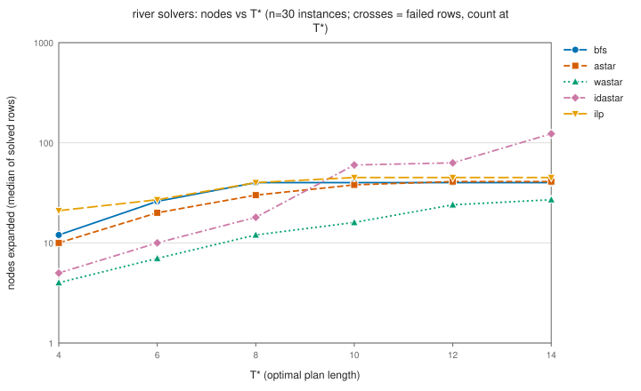

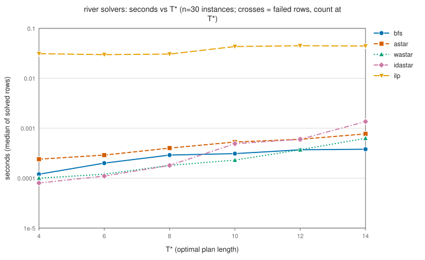

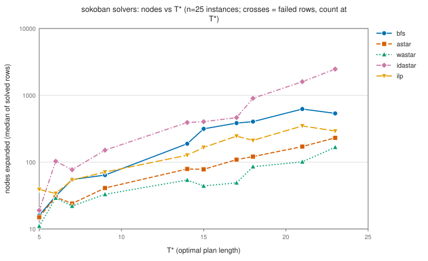

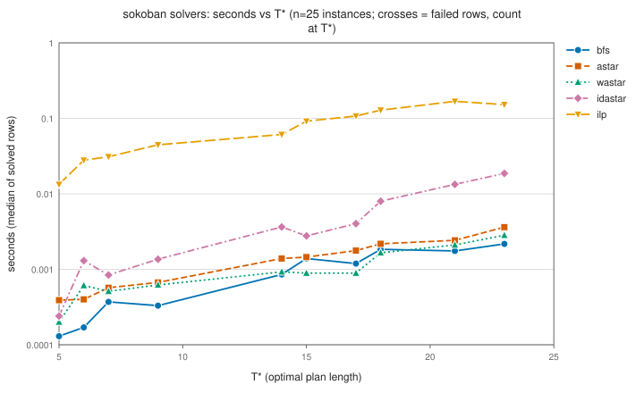

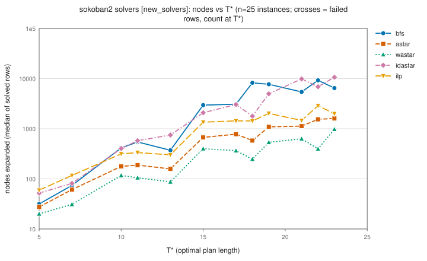

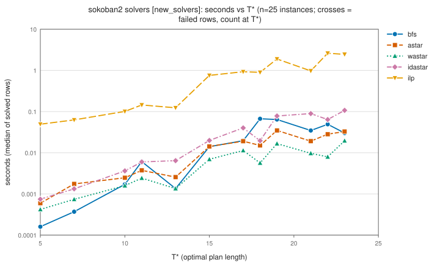

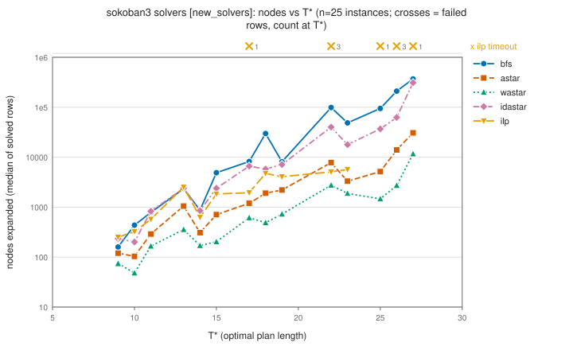

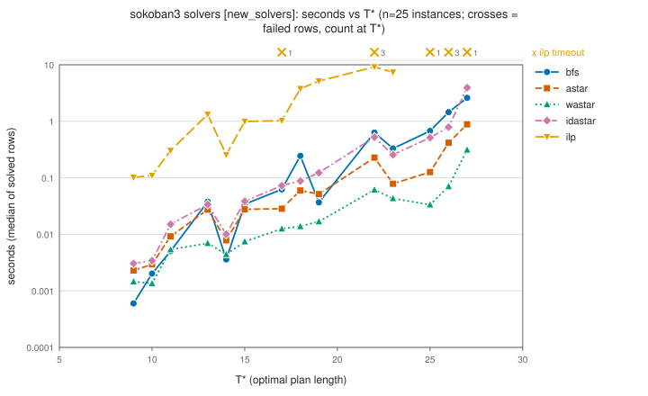

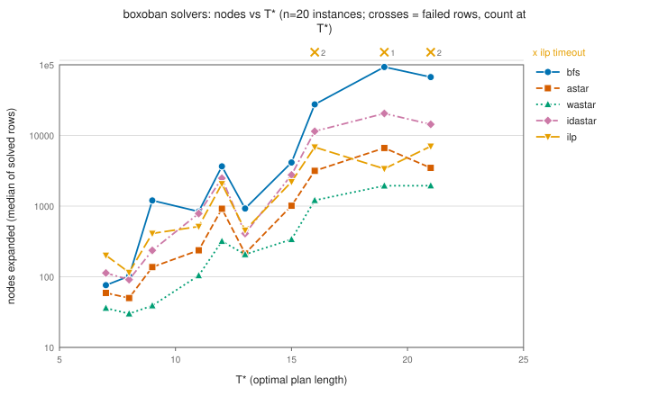

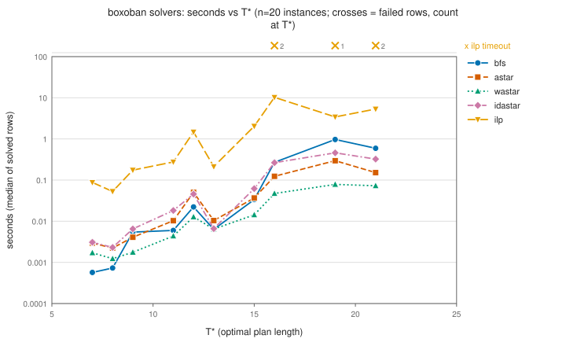

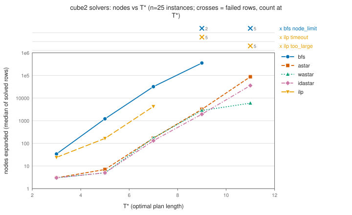

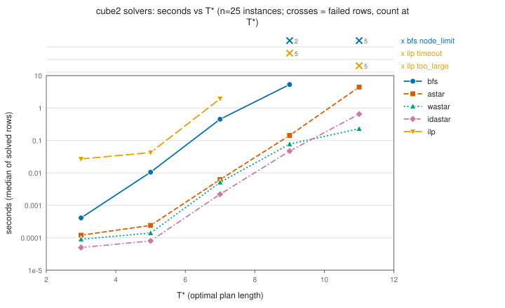

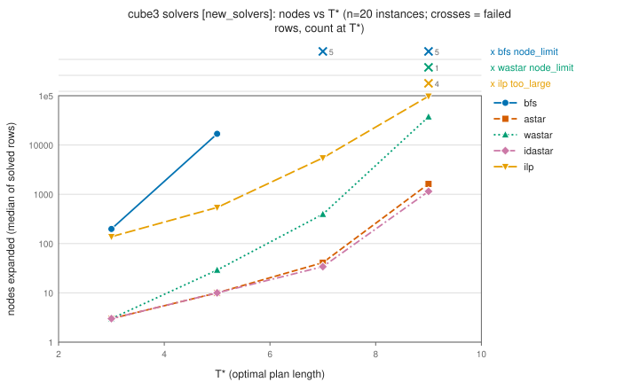

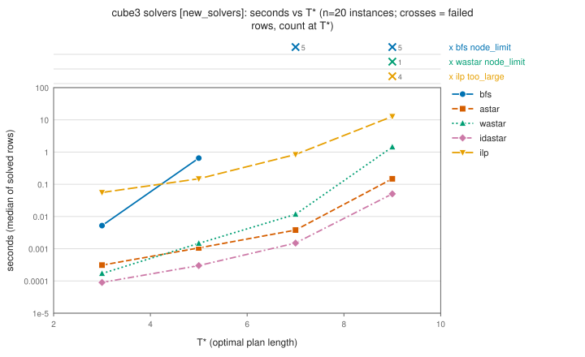


ILP solve rate by T* (95% Wilson): [river](figures/ilp_rate_river.svg), [sokoban](figures/ilp_rate_sokoban.svg), [sokoban2](figures/ilp_rate_sokoban2.svg), [sokoban3](figures/ilp_rate_sokoban3.svg), [boxoban](figures/ilp_rate_boxoban.svg), [cube2](figures/ilp_rate_cube2.svg), [cube3](figures/ilp_rate_cube3.svg).


### 7.2 Constrained, first design (`frac`)

Length budget T* + slack and resource budget R = floor(res_frac x resource of the unconstrained optimum), with the original resources (Sokoban family: 3 per push and 1 per move; River: passengers carried; cube: half-turn 2, quarter-turn 1). `skipped` rows are instances where A* proved the budget infeasible (or could not derive R).

| dataset | res_frac | bench | instances | skipped | A* ok | A* failures | ILP ok | ILP failures | A* cost > T* | ILP agrees with A* |
|---|---|---|---|---|---|---|---|---|---|---|
| main | 0.9 | river | 30 | 6 infeasible | 24 / 24 | none | 24 / 24 | none | 0 | 24 / 24 |
| main | 0.9 | sokoban | 25 | 25 infeasible | 0 / 0 | none | 0 / 0 | none | 0 | 0 / 0 |
| main | 0.9 | boxoban | 20 | 20 infeasible | 0 / 0 | none | 0 / 0 | none | 0 | 0 / 0 |
| main | 0.9 | cube2 | 25 | 18 infeasible | 6 / 7 | 1 node_limit | 0 / 7 | 2 timeout, 5 too_large | 0 | 0 / 0 |
| rf95 | 0.95 | sokoban | 25 | 24 infeasible | 1 / 1 | none | 1 / 1 | none | 1 | 1 / 1 |
| rf95 | 0.95 | boxoban | 20 | 20 infeasible | 0 / 0 | none | 0 / 0 | none | 0 | 0 / 0 |
| rf97 | 0.97 | sokoban | 25 | 23 infeasible | 2 / 2 | none | 2 / 2 | none | 2 | 2 / 2 |
| rf97 | 0.97 | boxoban | 20 | 20 infeasible | 0 / 0 | none | 0 / 0 | none | 0 | 0 / 0 |
| rf100 | 1.0 | sokoban | 25 | none | 25 / 25 | none | 25 / 25 | none | 0 | 25 / 25 |
| rf100 | 1.0 | boxoban | 20 | none | 20 / 20 | none | 14 / 20 | 6 timeout | 0 | 14 / 14 |


Across the runs with res_frac below 1 (190 instance-runs), 156 were infeasible at the resource budget and 3 of the 33 solved A* rows had cost above T*: this design is mostly infeasible and rarely forces a longer path, so the `bind` design replaces it. A likely reason (an argument, not a measurement): with these resources a cheaper path within the length slack needs fewer pushes on the Sokoban family, which almost never exists.

### 7.3 Constrained, binding design (`bind`)

Design. For each instance, r_opt is the least resource among paths of length <= T* and r_min the least resource among paths of length <= T* + c_slack (both by bisection over resource-constrained A*). If r_min >= r_opt the instance has no trade-off and is skipped (`no_tradeoff`). Otherwise level `bind` uses R = r_opt - 1, so every length-optimal path is infeasible, and level `tight` uses R = r_min when r_min < r_opt - 1. A* and the ILP both run at (T* + c_slack, R). A row is an (instance, level) pair. Resources: pushes only (Sokoban family, Boxoban), passengers squared (River), half-turns only (cubes); they were chosen because they create trade-offs.

Time ratio per row = ILP seconds / A* seconds on rows where both solved (seconds clamped below at 1e-05 s). The headline is the median of the per-row ratios; "ratio of mean seconds" (mean ILP seconds / mean A* seconds over the same rows) is the statistic quoted in the README and REPORT. It is pulled toward the slowest rows, so the two differ wherever the per-row ratios are skewed. "ILP faster (ILP failed)" counts rows where the ILP returned sooner than A* but with a failure status. Rows count (instance, level) pairs within one c_slack run; the c_slack runs of a benchmark re-use the same instances.

| bench | c_slack | dataset | instances | trade-off | skips | rows | A* ok | ILP ok | ILP failures | both ok | same cost | median ILP/A* time | range | ratio of mean seconds | ILP faster (both ok) | ILP faster (ILP failed) | cost - T* (A* ok rows) |
|---|---|---|---|---|---|---|---|---|---|---|---|---|---|---|---|---|---|
| river | 2 | bind_c2 | 120 | 43 | 77 no_tradeoff | 86 | 86 / 86 | 86 / 86 | none | 86 | 86 | 58x | 13x to 180x | 70x | 0 | 0 | +2: 86 |
| river | 4 | bind | 120 | 43 | 77 no_tradeoff | 86 | 86 / 86 | 86 / 86 | none | 86 | 86 | 63x | 25x to 152x | 66x | 0 | 0 | +2: 86 |
| river | 8 | bind_c8 | 120 | 43 | 77 no_tradeoff | 86 | 86 / 86 | 86 / 86 | none | 86 | 86 | 66x | 28x to 185x | 72x | 0 | 0 | +2: 86 |
| sokoban | 2 | bind_c2 | 90 | 7 | 83 no_tradeoff | 14 | 14 / 14 | 14 / 14 | none | 14 | 14 | 28x | 18x to 55x | 29x | 0 | 0 | +2: 14 |
| sokoban | 4 | bind | 90 | 7 | 83 no_tradeoff | 14 | 14 / 14 | 14 / 14 | none | 14 | 14 | 44x | 28x to 76x | 49x | 0 | 0 | +2: 14 |
| sokoban | 8 | bind_c8 | 90 | 7 | 83 no_tradeoff | 14 | 14 / 14 | 14 / 14 | none | 14 | 14 | 79x | 50x to 135x | 73x | 0 | 0 | +2: 14 |
| sokoban2 | 2 | bind_c2 | 100 | 3 | 97 no_tradeoff | 6 | 6 / 6 | 6 / 6 | none | 6 | 6 | 31x | 26x to 43x | 33x | 0 | 0 | +1: 2, +2: 4 |
| sokoban2 | 4 | bind_c4_new | 100 | 4 | 96 no_tradeoff | 8 | 8 / 8 | 8 / 8 | none | 8 | 8 | 58x | 40x to 95x | 60x | 0 | 0 | +1: 2, +2: 4, +3: 2 |
| sokoban2 | 8 | bind_c8 | 100 | 6 | 94 no_tradeoff | 12 | 12 / 12 | 8 / 12 | 4 timeout | 8 | 8 | 153x | 39x to 272x | 122x | 0 | 0 | +1: 2, +2: 4, +3: 2, +6: 2, +8: 2 |
| sokoban3 | 4 | bind_c4_new | 50 | 4 | 46 no_tradeoff | 8 | 8 / 8 | 4 / 8 | 4 timeout | 4 | 4 | 31x | 18x to 51x | 25x | 0 | 0 | +2: 6, +4: 2 |
| boxoban | 4 | bind | 40 | 1 | 39 no_tradeoff | 2 | 2 / 2 | 2 / 2 | none | 2 | 2 | 107x | 80x to 134x | 100x | 0 | 0 | +1: 2 |
| cube2 | 2 | bind_c2 | 20 | 18 | 2 no_tradeoff | 29 | 29 / 29 | 14 / 29 | 7 timeout, 8 too_large | 14 | 14 | 75x | 18x to 164x | 38x | 0 | 8 | +1: 18, +2: 11 |
| cube2 | 4 | bind | 20 | 18 | 2 no_tradeoff | 29 | 29 / 29 | 8 / 29 | 6 timeout, 15 too_large | 8 | 8 | 431x | 44x to 1270x | 228x | 0 | 8 | +1: 18, +2: 8, +3: 2, +4: 1 |
| cube2 | 8 | bind_c8 | 20 | 18 | 2 no_tradeoff | 29 | 29 / 29 | 0 / 29 | 3 timeout, 26 too_large | 0 | 0 | n/a | n/a | n/a | 0 | 8 | +1: 18, +2: 8, +3: 2, +4: 1 |
| cube3 | 4 | bind_c4_new | 20 | 17 | 2 no_tradeoff, 1 node_limit | 30 | 30 / 30 | 12 / 30 | 2 timeout, 16 too_large | 12 | 12 | 2236x | 394x to 8345x | 2231x | 0 | 3 | +1: 17, +2: 8, +3: 4, +4: 1 |


The c_slack sweep (benchmarks run at more than one c_slack): ILP ok / rows, trade-off instances, and median ILP/A* time ratio on rows where both solved.

| bench | c_slack 2 | c_slack 4 | c_slack 8 |
|---|---|---|---|
| `river` | ILP 86/86, 43 inst., 58x | ILP 86/86, 43 inst., 63x | ILP 86/86, 43 inst., 66x |
| `sokoban` | ILP 14/14, 7 inst., 28x | ILP 14/14, 7 inst., 44x | ILP 14/14, 7 inst., 79x |
| `sokoban2` | ILP 6/6, 3 inst., 31x | ILP 8/8, 4 inst., 58x | ILP 8/12, 6 inst., 153x |
| `cube2` | ILP 14/29, 18 inst., 75x | ILP 8/29, 18 inst., 431x | ILP 0/29, 18 inst., n/a |


What the sweep measures. At level `bind` the resource budget R = r_opt - 1 and the constrained optimum do not depend on c_slack (r_opt is defined at length T*), so A* has the same search problem on every instance in every run, while the ILP's graph is the ball of states within T* + c_slack steps and grows with c_slack. Mean nodes over the `bind`-level rows (including rows where a solver failed): `river` (c_slack 2 / 4 / 8) A* 42.5 at every c_slack and ILP 30.3 / 32.0 / 37.4; `sokoban` (c_slack 2 / 4 / 8) A* 276.1 at every c_slack and ILP 268.0 / 397.1 / 496.7; `sokoban2` (c_slack 2 / 4 / 8) A* 1,126.0 / 1,221.8 / 2,012.5 and ILP 1,171.0 / 1,899.5 / 3,774.3 (the A* means differ because the set of trade-off instances differs between runs: 3 / 4 / 6 instances); `cube2` (c_slack 2 / 4 / 8) A* 41,166.6 at every c_slack and ILP 131,418.2 / 243,148.5 / 433,078.5. The sweep therefore mostly shows how the edge-flow ILP scales with a slack length budget; it is not a harder trade-off for A*.


- Over all benchmarks and c_slack values: the ILP solved 362 of 453 (instance, level, c_slack) rows (A* 453 of 453; A* by construction: instances and budgets are derived with A*); on the 362 rows where both solved (77 distinct instances; the c_slack runs of a benchmark re-use the same instances) it returned the same cost as A* on 362 and was faster on 0; the per-(benchmark, c_slack) median ILP/A* time ratio lies between 28x and 2236x.
- Distinct instances: 440 over all bind runs, 96 of them with a trade-off in at least one c_slack run. Instance identity across the c_slack runs of a benchmark: an instance's position in generation order within its benchmark (every c_slack run of a benchmark uses the same seed and n, so make_instances yields the same instances in the same order); the key is accepted only if the T* sequence and every recorded r_opt (which does not depend on c_slack) agree across the runs.
- ILP failures: 26 timeout, 65 too_large. On 27 rows the ILP returned before A* with a failure status (a fast failure, not a win).
- Skipped: 860 no_tradeoff, 1 node_limit instance-runs; `no_tradeoff` covers 346 distinct instances (343 of them `no_tradeoff` in every c_slack run of their benchmark).

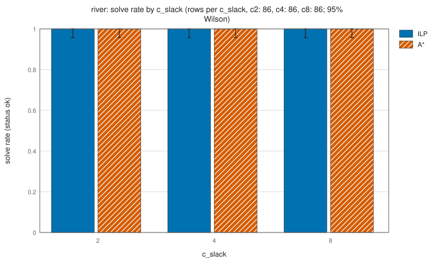

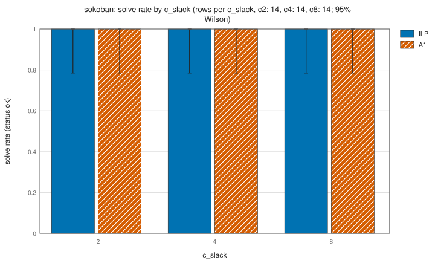

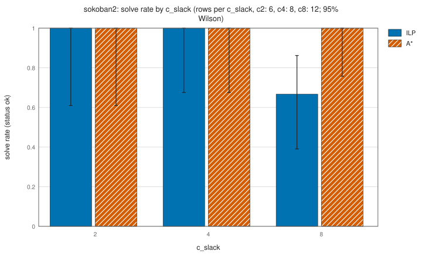

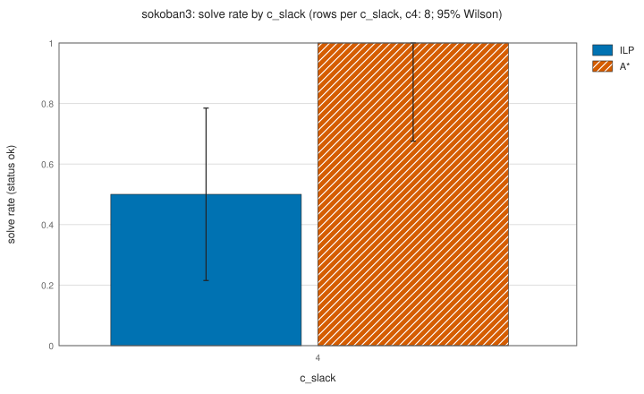

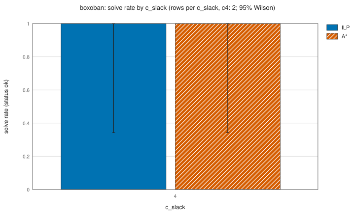

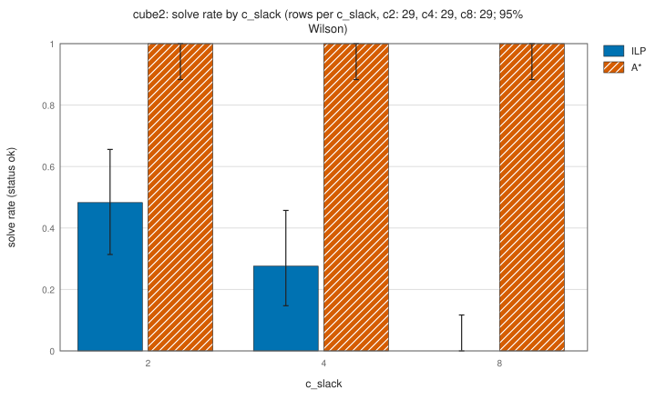

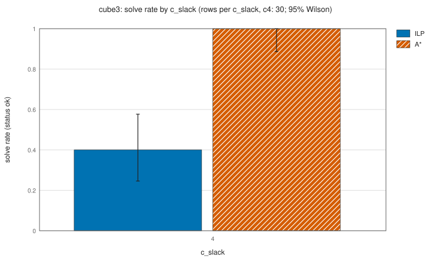


ILP vs A* seconds per row (log-log, failures marked): [river c2](figures/bind_scatter_river_c2.svg), [river c4](figures/bind_scatter_river_c4.svg), [river c8](figures/bind_scatter_river_c8.svg), [sokoban c2](figures/bind_scatter_sokoban_c2.svg), [sokoban c4](figures/bind_scatter_sokoban_c4.svg), [sokoban c8](figures/bind_scatter_sokoban_c8.svg), [sokoban2 c2](figures/bind_scatter_sokoban2_c2.svg), [sokoban2 c4](figures/bind_scatter_sokoban2_c4.svg), [sokoban2 c8](figures/bind_scatter_sokoban2_c8.svg), [sokoban3 c4](figures/bind_scatter_sokoban3_c4.svg), [boxoban c4](figures/bind_scatter_boxoban_c4.svg), [cube2 c2](figures/bind_scatter_cube2_c2.svg), [cube2 c4](figures/bind_scatter_cube2_c4.svg), [cube2 c8](figures/bind_scatter_cube2_c8.svg), [cube3 c4](figures/bind_scatter_cube3_c4.svg).


### 7.4 Agents under noise

Success within budget (B = T* + slack) under planning error delta and execution noise eta (Section 4.4). Pooled success: successes = sum over instances of round(success x episodes), trials = episodes x instances, 95% Wilson interval (it treats the trials as independent). Paired differences: mean over instances of the per-instance success difference, 95% percentile bootstrap over instances. **react and tape are simulated.**

One agents dataset per benchmark is used: the one with the most episodes per instance. Superseded and left out of every table and aggregate below: `main` on `river` (100 episodes; replaced by `agents_ep300`, 300 episodes) and `main` on `sokoban` (100 episodes; replaced by `agents_ep300`, 300 episodes). A later run of the same benchmark with the same seed and `--n` re-uses the same instances and per-instance noise seeds, so its first episodes repeat the earlier run's; counting both would count the same episodes twice.

| dataset | bench | method | instances | episodes/instance | successes / trials | success | 95% Wilson |
|---|---|---|---|---|---|---|---|
| `agents_ep300` | `river` | react (simulated) | 30 | 300 | 4151 / 9000 | 0.461 | [0.451, 0.472] |
| `agents_ep300` | `river` | tape (simulated) | 30 | 300 | 8569 / 9000 | 0.952 | [0.948, 0.956] |
| `agents_ep300` | `river` | ours_astar | 30 | 300 | 8592 / 9000 | 0.955 | [0.950, 0.959] |
| `agents_ep300` | `river` | ours_ilp | 30 | 300 | 8643 / 9000 | 0.960 | [0.956, 0.964] |
| `agents_ep300` | `sokoban` | react (simulated) | 25 | 300 | 1845 / 7500 | 0.246 | [0.236, 0.256] |
| `agents_ep300` | `sokoban` | tape (simulated) | 25 | 300 | 6432 / 7500 | 0.858 | [0.850, 0.865] |
| `agents_ep300` | `sokoban` | ours_astar | 25 | 300 | 6509 / 7500 | 0.868 | [0.860, 0.875] |
| `agents_ep300` | `sokoban` | ours_ilp | 25 | 300 | 6510 / 7500 | 0.868 | [0.860, 0.875] |
| `new_agents` | `sokoban2` | react (simulated) | 25 | 100 | 535 / 2500 | 0.214 | [0.198, 0.231] |
| `new_agents` | `sokoban2` | tape (simulated) | 25 | 100 | 2104 / 2500 | 0.842 | [0.827, 0.855] |
| `new_agents` | `sokoban2` | ours_astar | 25 | 100 | 2126 / 2500 | 0.850 | [0.836, 0.864] |
| `new_agents` | `sokoban2` | ours_ilp | 25 | 100 | 2130 / 2500 | 0.852 | [0.838, 0.865] |
| `new_agents` | `sokoban3` | react (simulated) | 25 | 30 | 100 / 750 | 0.133 | [0.111, 0.160] |
| `new_agents` | `sokoban3` | tape (simulated) | 25 | 30 | 597 / 750 | 0.796 | [0.766, 0.823] |
| `new_agents` | `sokoban3` | ours_astar | 25 | 30 | 620 / 750 | 0.827 | [0.798, 0.852] |
| `main` | `boxoban` | react (simulated) | 20 | 20 | 90 / 400 | 0.225 | [0.187, 0.268] |
| `main` | `boxoban` | tape (simulated) | 20 | 20 | 340 / 400 | 0.850 | [0.812, 0.882] |
| `main` | `boxoban` | ours_astar | 20 | 20 | 342 / 400 | 0.855 | [0.817, 0.886] |
| `main` | `cube2` | react (simulated) | 25 | 30 | 404 / 750 | 0.539 | [0.503, 0.574] |
| `main` | `cube2` | tape (simulated) | 25 | 30 | 725 / 750 | 0.967 | [0.951, 0.977] |
| `main` | `cube2` | ours_astar | 25 | 30 | 724 / 750 | 0.965 | [0.950, 0.976] |


Smallest and largest T* bucket per benchmark (success, 95% Wilson):

| dataset | bench | T* | react (simulated) | tape (simulated) | ours_astar | ours_ilp |
|---|---|---|---|---|---|---|
| `agents_ep300` | `river` | 4 | 0.760 [0.738, 0.781] | 0.993 [0.987, 0.996] | 0.993 [0.988, 0.996] | 0.993 [0.987, 0.996] |
| `agents_ep300` | `river` | 14 | 0.266 [0.244, 0.289] | 0.935 [0.922, 0.947] | 0.946 [0.933, 0.956] | 0.943 [0.930, 0.953] |
| `agents_ep300` | `sokoban` | 5 | 0.643 [0.588, 0.695] | 0.963 [0.936, 0.979] | 0.963 [0.936, 0.979] | 0.963 [0.936, 0.979] |
| `agents_ep300` | `sokoban` | 23 | 0.042 [0.028, 0.061] | 0.732 [0.695, 0.766] | 0.782 [0.747, 0.813] | 0.772 [0.736, 0.803] |
| `new_agents` | `sokoban2` | 5 | 0.630 [0.561, 0.694] | 0.975 [0.943, 0.989] | 0.975 [0.943, 0.989] | 0.980 [0.950, 0.992] |
| `new_agents` | `sokoban2` | 23 | 0.040 [0.016, 0.098] | 0.800 [0.711, 0.867] | 0.820 [0.733, 0.883] | 0.810 [0.722, 0.875] |
| `new_agents` | `sokoban3` | 9 | 0.433 [0.274, 0.608] | 0.967 [0.833, 0.994] | 0.967 [0.833, 0.994] | not run |
| `new_agents` | `sokoban3` | 27 | 0.000 [0.000, 0.114] | 0.667 [0.488, 0.808] | 0.733 [0.556, 0.858] | not run |
| `main` | `boxoban` | 7 | 0.533 [0.409, 0.654] | 0.983 [0.911, 0.997] | 0.983 [0.911, 0.997] | not run |
| `main` | `boxoban` | 21 | 0.050 [0.017, 0.137] | 0.800 [0.682, 0.882] | 0.817 [0.701, 0.894] | not run |
| `main` | `cube2` | 3 | 0.840 [0.773, 0.890] | 1.000 [0.975, 1.000] | 1.000 [0.975, 1.000] | not run |
| `main` | `cube2` | 11 | 0.320 [0.251, 0.398] | 0.947 [0.898, 0.973] | 0.940 [0.890, 0.968] | not run |


Paired differences in success:

| dataset | bench | comparison | instances | mean difference | 95% bootstrap CI |
|---|---|---|---|---|---|
| `agents_ep300` | `river` | ours_astar - tape (simulated) | 30 | +0.0026 | [+0.0009, +0.0044] |
| `agents_ep300` | `river` | ours_astar - react (simulated) | 30 | +0.4934 | [+0.4329, +0.5493] |
| `agents_ep300` | `sokoban` | ours_astar - tape (simulated) | 25 | +0.0103 | [+0.0032, +0.0181] |
| `agents_ep300` | `sokoban` | ours_astar - react (simulated) | 25 | +0.6219 | [+0.5749, +0.6647] |
| `new_agents` | `sokoban2` | ours_astar - tape (simulated) | 25 | +0.0088 | [+0.0028, +0.0156] |
| `new_agents` | `sokoban2` | ours_astar - react (simulated) | 25 | +0.6364 | [+0.5880, +0.6784] |
| `new_agents` | `sokoban3` | ours_astar - tape (simulated) | 25 | +0.0307 | [+0.0147, +0.0493] |
| `new_agents` | `sokoban3` | ours_astar - react (simulated) | 25 | +0.6933 | [+0.6547, +0.7307] |
| `main` | `boxoban` | ours_astar - tape (simulated) | 20 | +0.0050 | [-0.0050, +0.0150] |
| `main` | `boxoban` | ours_astar - react (simulated) | 20 | +0.6300 | [+0.5625, +0.6975] |
| `main` | `cube2` | ours_astar - tape (simulated) | 25 | -0.0013 | [-0.0067, +0.0027] |
| `main` | `cube2` | ours_astar - react (simulated) | 25 | +0.4267 | [+0.3587, +0.4893] |


- `river` (`agents_ep300`): ours_astar minus tape (simulated): +0.0026 [+0.0009, +0.0044] over 30 instances; the interval excludes 0.
- `river` (`agents_ep300`): ours_astar minus react (simulated): +0.4934 [+0.4329, +0.5493] over 30 instances; the interval excludes 0.
- `river` (`agents_ep300`): tape (simulated) and ours_astar have identical success on 12 of 30 instances (tape higher on 4, lower on 14).
- `sokoban` (`agents_ep300`): ours_astar minus tape (simulated): +0.0103 [+0.0032, +0.0181] over 25 instances; the interval excludes 0.
- `sokoban` (`agents_ep300`): ours_astar minus react (simulated): +0.6219 [+0.5749, +0.6647] over 25 instances; the interval excludes 0.
- `sokoban` (`agents_ep300`): tape (simulated) and ours_astar have identical success on 9 of 25 instances (tape higher on 5, lower on 11).
- `sokoban2` (`new_agents`): ours_astar minus tape (simulated): +0.0088 [+0.0028, +0.0156] over 25 instances; the interval excludes 0.
- `sokoban2` (`new_agents`): ours_astar minus react (simulated): +0.6364 [+0.5880, +0.6784] over 25 instances; the interval excludes 0.
- `sokoban2` (`new_agents`): tape (simulated) and ours_astar have identical success on 11 of 25 instances (tape higher on 3, lower on 11).
- `sokoban3` (`new_agents`): ours_astar minus tape (simulated): +0.0307 [+0.0147, +0.0493] over 25 instances; the interval excludes 0.
- `sokoban3` (`new_agents`): ours_astar minus react (simulated): +0.6933 [+0.6547, +0.7307] over 25 instances; the interval excludes 0.
- `sokoban3` (`new_agents`): tape (simulated) and ours_astar have identical success on 12 of 25 instances (tape higher on 1, lower on 12).
- `sokoban3` (`new_agents`): ILP disabled in this run (no ours_ilp rows; tape (simulated) used BFS on the folded graph).
- `boxoban` (`main`): ours_astar minus tape (simulated): +0.0050 [-0.0050, +0.0150] over 20 instances; the interval contains 0.
- `boxoban` (`main`): ours_astar minus react (simulated): +0.6300 [+0.5625, +0.6975] over 20 instances; the interval excludes 0.
- `boxoban` (`main`): tape (simulated) and ours_astar have identical success on 16 of 20 instances (tape higher on 1, lower on 3).
- `boxoban` (`main`): ILP disabled in this run (no ours_ilp rows; tape (simulated) used BFS on the folded graph).
- `cube2` (`main`): ours_astar minus tape (simulated): -0.0013 [-0.0067, +0.0027] over 25 instances; the interval contains 0.
- `cube2` (`main`): ours_astar minus react (simulated): +0.4267 [+0.3587, +0.4893] over 25 instances; the interval excludes 0.
- `cube2` (`main`): tape (simulated) and ours_astar have identical success on 22 of 25 instances (tape higher on 2, lower on 1).
- `cube2` (`main`): ILP disabled in this run (no ours_ilp rows; tape (simulated) used BFS on the folded graph).

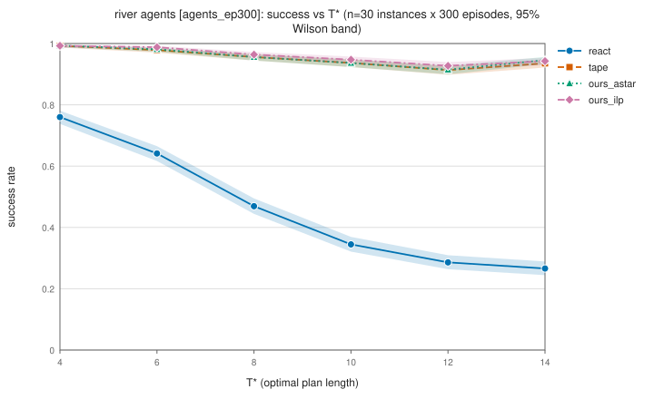

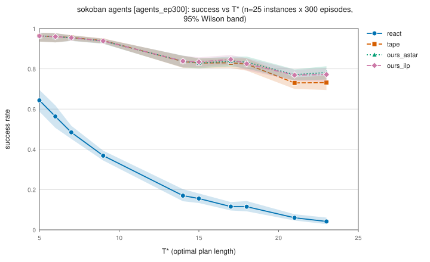

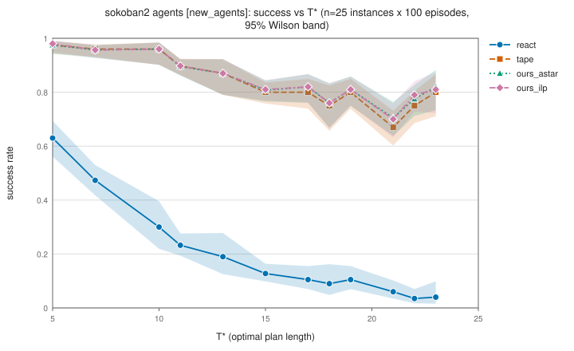

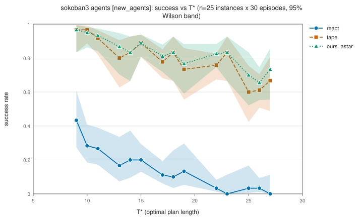

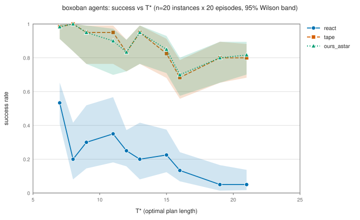

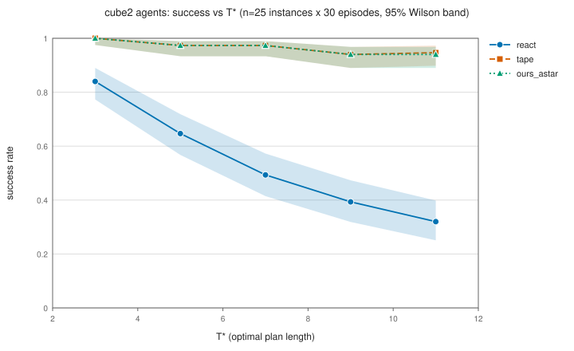


_Not completed: the cube3 agents run was attempted twice and did not complete. The full run (`--n 5 --episodes 20 --no_ilp --max_nodes 100000`) was stopped after 3 h (176 CPU-minutes) and a reduced run (`--n 2 --episodes 10`, same flags) after 54 min (53 CPU-minutes); neither wrote a result file, because the agents CSV is written only when a benchmark's run ends. The likely cause, not verified, is the exact-distance oracle (A* with a corner-only pattern database, about 10k nodes/s, 300,000-node cap) that the simulated ReAct and TAPE query on every off-path state. There is no `docs/data/new_agents/agents_cube3.csv`, so the agents comparison covers 6 benchmarks. Its tables appear here if a future run writes the file._


<!-- INTERPRETATION-7.4 -->
**Interpretation** (hand-written after the agents data landed; every number is quoted from the tables above; this block is the only hand-written part of section 7.4 and the generator preserves it).

1. *Against simulated ReAct the gap is large and universal.* Re-planning with A* on the true graph beats the simulated ReAct by +0.43 (cube2) to +0.69 (sokoban3) in mean per-instance success, and every paired interval excludes 0. This gap is a property of the noise model: the simulated ReAct takes every injected planning error and never corrects it, so it says nothing about how a real language model behaves.
2. *Against simulated TAPE the difference is small but, on four benchmarks, not zero.* The paired difference ours_astar minus tape is +0.003 (river, 300 episodes), +0.010 (sokoban, 300), +0.009 (sokoban2, 100) and +0.031 (sokoban3, 30), and each of those intervals excludes 0. On boxoban (+0.005) and cube2 (-0.001), which have 20 and 30 episodes per instance and an ILP-disabled tape, the intervals contain 0. Where tape differs from ours_astar it is lower on more instances than it is higher (river 14 vs 4, sokoban 11 vs 5, sokoban2 11 vs 3, sokoban3 12 vs 1). On sokoban the per-bucket gap is largest at the longest bucket (T* 23: tape 0.732, ours_astar 0.782); on sokoban2 and sokoban3 the largest bucket gaps sit at T* 21 and T* 25, near but not at the longest bucket (sokoban3 T* 27: tape 0.667 vs ours_astar 0.733, with overlapping Wilson intervals), and buckets there hold one to three instances, so the trend with T* is suggestive, not established. A plausible mechanism is that 16 noisy rollouts are less likely to contain an optimal path as T* grows, so the folded-graph path is sometimes longer than optimal; this fits the pattern but was not tested here. An earlier version of this project described the difference as not shown to matter; with 300 episodes on river and sokoban and four benchmarks it is small (at most 0.031 in mean success) but distinguishable from 0.
3. *The ILP planner matches A* as a planner.* ours_ilp and ours_astar are within 0.006 of each other on the three benchmarks where both ran (river 0.960 vs 0.955, sokoban 0.868 vs 0.868, sokoban2 0.852 vs 0.850), which is expected because both plan optimally on the true graph; the ILP's cost is time (Section 7.3, and the seconds columns of the agents CSVs, which are contended by parallel runs).
4. *Success declines with T* for every re-planning method, most on push-based puzzles.* At the largest T* bucket ours_astar reaches 0.946 on river (T* 14) and 0.940 on cube2 (T* 11, 30 episodes) but 0.782 on sokoban (T* 23), 0.820 on sokoban2 (T* 23) and 0.733 on sokoban3 (T* 27). This is consistent with errors being recoverable in reversible domains and irrecoverable on pushes, but the buckets differ in T*, in instance counts and in episodes, so the cause is not isolated.
5. *Cautions.* The baselines are simulated; the pooled Wilson intervals treat episodes as independent although episodes of one instance share a level (the paired bootstrap over instances is the honest comparison); sokoban3, boxoban and cube2 use fewer episodes and no ILP in the agents runs; there are no agents results for cube3: two attempts (n = 5 with 20 episodes, and a reduced n = 2 with 10 episodes, both with the ILP disabled) were stopped after 3 h and 54 min without writing a result, so the agents comparison covers six benchmarks, not seven.
<!-- /INTERPRETATION-7.4 -->

## 8 Limitations and threats to validity

1. **The baselines are simulated.** react (simulated) and tape (simulated) use the TAPE paper's noise model and say nothing about how a real language model behaves. The gap between ours_astar and react (simulated), 0.427 to 0.693 in mean per-instance success, comes from the modelling assumption that planning errors are injected unfiltered and never corrected.
2. **tape (simulated) and ours are close in success.** A hypothesis for why (not tested here): tape's rollouts come from an exact oracle with injected errors, so a shortest path in the folded graph is (close to) an optimal path of the true graph, which ours_astar follows. They have identical success on 82 of 150 instances over 6 benchmarks (one agents dataset per benchmark, Section 7.4). Measured: ours_astar minus tape (simulated) is -0.001 to 0.031 in mean per-instance success; the success difference is small (at most 0.031 in absolute value) but its bootstrap interval excludes 0 on 4 of 6 benchmarks (`river`, `sokoban`, `sokoban2` and `sokoban3`), so it is not always indistinguishable from 0. The difference that does not depend on the noise model is cost: ours needs no oracle, no rollouts and no ILP.
3. **Constrained evidence is thin on some benchmarks and the resources are unusual.** Fewer than 10 trade-off instances at every c_slack run: `sokoban` (c2: 7, c4: 7, c8: 7), `sokoban2` (c2: 3, c4: 4, c8: 6), `sokoban3` (c4: 4) and `boxoban` (c4: 1). The `bind` resources (pushes only, passengers squared, half-turns only) were chosen because they create trade-offs, so the experiment tests solver behaviour under a binding budget, not a realistic cost model. A* `ok` at the `tight` level repeats the bisection's last probe, so A*'s solve rate there is not informative; the ILP's behaviour is. The c_slack sweep mostly measures the ILP's subgraph growth: at the `bind` level R = r_opt - 1 and the constrained optimum do not depend on c_slack, so A* expands the same nodes in every run while the ILP's explicit ball {g + h <= T* + c_slack} grows with the length budget (node means in Section 7.3). ILP failures at larger c_slack are therefore a statement about the edge-flow ILP's sensitivity to a slack length budget, not about a harder trade-off. Instances where A* fails during the bisection are skipped, which biases the sample toward instances A* can handle.
4. **Fairness between the ILP and A* is approximate.** The ILP's subgraph is the ball {g + h <= budget}, i.e. {g + h <= T* + slack} in the unconstrained runs and {g + h <= T* + c_slack} in the `bind` runs (larger than the region A* expands, built without resource pruning), its graph build counts toward its time, it runs 8 CP-SAT workers against single-threaded A*, and it has a 10 s solver limit that A* lacks.
5. **Agents run sizes.** Episodes per instance: `river` (`agents_ep300`) 300, `sokoban` (`agents_ep300`) 300, `sokoban2` (`new_agents`) 100, `sokoban3` (`new_agents`) 30, `boxoban` (`main`) 20, `cube2` (`main`) 30. ILP disabled (no ours_ilp rows; tape used BFS on the folded graph): `sokoban3` (`new_agents`), `boxoban` (`main`) and `cube2` (`main`). Buckets hold 1 to 5 instances, so success differences of a few points are within noise. Older agents CSVs have no `episodes` column; their episode counts come from the documented lookup `tapegraph.bench.DOCUMENTED_EPISODES`.
6. **Timing columns.** Wall-clock `seconds` depend on what else ran on the machine; every agents run (`main`, `new_agents`, `agents_ep300`) ran as parallel processes next to other work (README), so every agents `seconds` column is contended and inflated. react and tape `seconds` include oracle computations and are not comparable to ours_*.
7. **Node caps.** Runs with a node cap below the default: `cube3` at 100,000; the oracle that fixes T* and drives the simulated baselines has its own 300,000-node cap (an instance it cannot solve is never generated). Solver failures at the cap are failures of that configuration, not proofs of infeasibility.
8. **Pooled Wilson intervals assume independent episodes.** Episodes of one instance share the level, so the pooled intervals are optimistic; the paired bootstrap resamples instances and is the more conservative comparison.


**Threats to validity.** The comparison with ReAct and TAPE is a comparison with simulations under one noise model; a real language model's errors are neither independent nor uniformly harmful, and TAPE's real cost (LLM calls) is absent. The ILP-vs-A* comparison favours A* in graph size (A* expands only what it needs, the ILP builds the whole {g + h <= T* + slack} ball, {g + h <= T* + c_slack} in the `bind` runs, and counts that build) and favours the ILP in parallelism (8 workers); the ILP also stops at 10 s and reports `timeout` for any outcome short of proven optimality or infeasibility, while A* runs to its node cap. The verdicts below are about this edge-flow formulation, these limits and these benchmarks.

## 9 Reproducibility

```bash
pip install -e ".[test]"                     # numpy, ortools, pytest
python -m pytest -q
tapegraph all --profile smoke --out smoke_out   # tiny end-to-end pass (River, Cube2)
tapegraph all --profile full  --out full_out    # the published main and bind commands, sequentially
python scripts/make_figures.py                  # docs/figures/*.svg from docs/data
python scripts/make_paper.py                    # this file from docs/data and docs/figures
```

`all --profile full` writes `run_manifest.json` (commands, parameters, seconds per step, git commit, versions). The other datasets come from the commands in Section 6. Both generators are deterministic: re-running them on the same data gives byte-identical files. Data layout (`<kind>_<bench>.csv`, kind in solvers | agents | constrained):

| dataset | files |
|---|---|
| `docs/data/agents_ep300/` | agents_river, agents_sokoban |
| `docs/data/bind/` | constrained_boxoban, constrained_cube2, constrained_river, constrained_sokoban |
| `docs/data/bind_c2/` | constrained_cube2, constrained_river, constrained_sokoban, constrained_sokoban2 |
| `docs/data/bind_c4_new/` | constrained_cube3, constrained_sokoban2, constrained_sokoban3 |
| `docs/data/bind_c8/` | constrained_cube2, constrained_river, constrained_sokoban, constrained_sokoban2 |
| `docs/data/main/` | agents_boxoban, agents_cube2, agents_river, agents_sokoban, constrained_boxoban, constrained_cube2, constrained_river, constrained_sokoban, solvers_boxoban, solvers_cube2, solvers_river, solvers_sokoban |
| `docs/data/new_agents/` | agents_sokoban2, agents_sokoban3 |
| `docs/data/new_solvers/` | solvers_cube3, solvers_sokoban2, solvers_sokoban3 |
| `docs/data/rf100/` | constrained_boxoban, constrained_sokoban |
| `docs/data/rf95/` | constrained_boxoban, constrained_sokoban |
| `docs/data/rf97/` | constrained_boxoban, constrained_sokoban |


Figures available under `docs/figures/` when this file was generated (49): `agents_boxoban.svg`, `agents_cube2.svg`, `agents_river_agents_ep300.svg`, `agents_sokoban2.svg`, `agents_sokoban3.svg`, `agents_sokoban_agents_ep300.svg`, `bind_cslack_boxoban.svg`, `bind_cslack_cube2.svg`, `bind_cslack_cube3.svg`, `bind_cslack_river.svg`, `bind_cslack_sokoban.svg`, `bind_cslack_sokoban2.svg`, `bind_cslack_sokoban3.svg`, `bind_scatter_boxoban_c4.svg`, `bind_scatter_cube2_c2.svg`, `bind_scatter_cube2_c4.svg`, `bind_scatter_cube2_c8.svg`, `bind_scatter_cube3_c4.svg`, `bind_scatter_river_c2.svg`, `bind_scatter_river_c4.svg`, `bind_scatter_river_c8.svg`, `bind_scatter_sokoban2_c2.svg`, `bind_scatter_sokoban2_c4.svg`, `bind_scatter_sokoban2_c8.svg`, `bind_scatter_sokoban3_c4.svg`, `bind_scatter_sokoban_c2.svg`, `bind_scatter_sokoban_c4.svg`, `bind_scatter_sokoban_c8.svg`, `ilp_rate_boxoban.svg`, `ilp_rate_cube2.svg`, `ilp_rate_cube3.svg`, `ilp_rate_river.svg`, `ilp_rate_sokoban.svg`, `ilp_rate_sokoban2.svg`, `ilp_rate_sokoban3.svg`, `solvers_nodes_boxoban.svg`, `solvers_nodes_cube2.svg`, `solvers_nodes_cube3.svg`, `solvers_nodes_river.svg`, `solvers_nodes_sokoban.svg`, `solvers_nodes_sokoban2.svg`, `solvers_nodes_sokoban3.svg`, `solvers_seconds_boxoban.svg`, `solvers_seconds_cube2.svg`, `solvers_seconds_cube3.svg`, `solvers_seconds_river.svg`, `solvers_seconds_sokoban.svg`, `solvers_seconds_sokoban2.svg`, `solvers_seconds_sokoban3.svg`.

## 10 Conclusion

For BFS, A*, IDA* and the ILP, every solved path had length exactly T* (635 solved rows), and A* with a pattern database or distance heuristic solved every unconstrained instance it was given. Instances exist only where the oracle (an exact table, or A* with a 300,000-node cap) found T*, so this sample excludes instances that A*-based search could not solve (the node-cap limitation in Section 8).

The ILP did not beat A* in any measured regime. Unconstrained: the ILP solved 142 of 170 unconstrained instances (A* 170 of 170; A* by construction: instances and budgets are derived with A*) and was faster than A* on 0 of the 142 where both solved. Binding-constrained (7 benchmarks; c_slack 2, 4 and 8, not every value on every benchmark): the ILP solved 362 of 453 (instance, level, c_slack) rows (A* 453 of 453; A* by construction: instances and budgets are derived with A*); on the 362 rows where both solved (77 distinct instances; the c_slack runs of a benchmark re-use the same instances) it returned the same cost as A* on 362 and was faster on 0. On 27 (instance, level, c_slack) rows the ILP returned before A* but with a failure status; a fast failure is not a win. This is scoped to the edge-flow formulation, the time limit, the node caps and the resources measured here; it does not show that an ILP cannot win with other objectives (e.g. TAPE's node scores), other formulations or much larger graphs.

Re-planning on the true graph beats simulated ReAct by 0.427 to 0.693 in mean success; against simulated TAPE the bootstrap interval of the difference contains 0 on 2 of 6 benchmarks; it excludes 0 with ours_astar higher on 4 (by at most 0.031) and with ours_astar lower on 0. Because both baselines are simulations that share an exact oracle, this supports the claim that the loop recovers TAPE's success without a language model only within that model.

What the evidence does not support: anything about real language models, about resources an application would care about, or about benchmarks beyond the generated ones (no real Boxoban levels were run).

## References

- Culberson (1997). Sokoban is PSPACE-complete.
- Google OR-Tools, CP-SAT solver.
- Guez et al. (2019). An investigation of model-free planning. (Source of Boxoban.)
- Hart, Nilsson, Raphael (1968). A Formal Basis for the Heuristic Determination of Minimum Cost Paths (A*). IEEE Transactions on Systems Science and Cybernetics.
- Jeong, Kim, Lee (2026). TAPE. arXiv:2602.19633.
- Korf (1985). Depth-first iterative-deepening: An optimal admissible tree search (IDA*). Artificial Intelligence 27.
- Korf (1997). Finding optimal solutions to Rubik's Cube using pattern databases. AAAI.
- Yao et al. (2022). ReAct: Synergizing Reasoning and Acting in Language Models.
