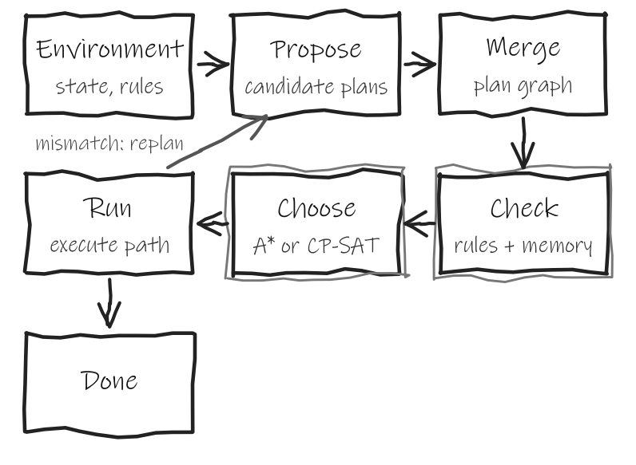
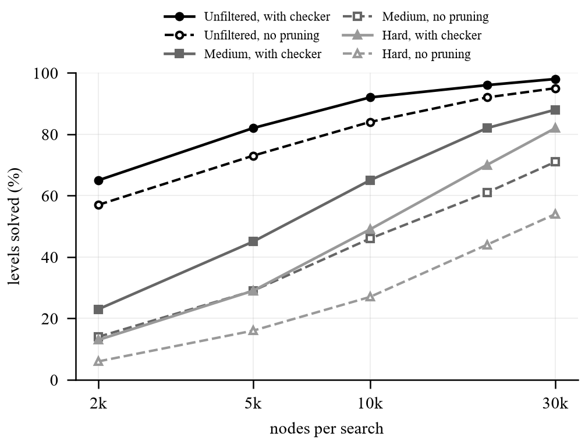
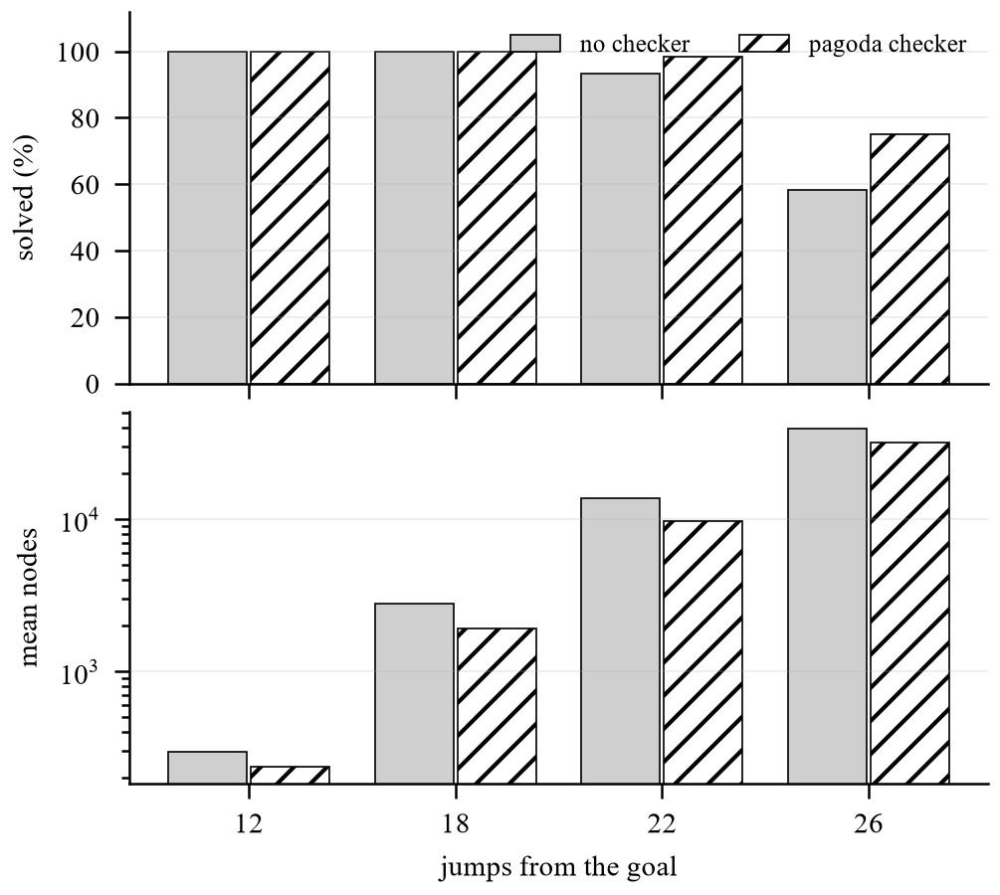
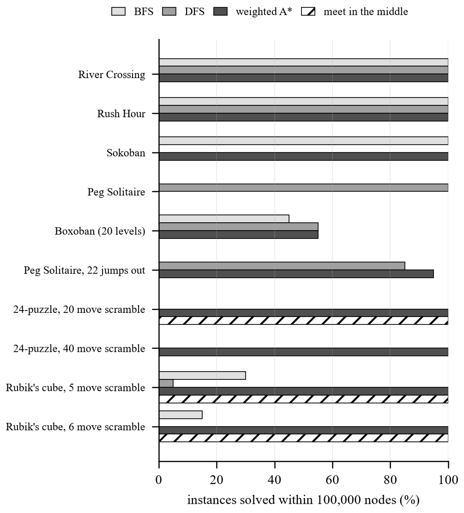

# Rule Checking and Adaptive Solver Choice for Plan-Graph Planning

> Builder note, not part of the paper. paper.docx is generated from this file by build_paper_docx.py. Figures come from make_figures.py. Every number below was copied from a file in results/.

## Abstract

TAPE builds one graph out of several candidate plans and hands the choice of path to a solver. It never asks whether a move is allowed by the task's rules, and it uses one solver for every problem. We bolted three things onto it. Each game gets a rule checker that throws out or discounts moves. A small database remembers which moves failed before. And a cost-based rule picks A* or a constraint solver depending on how many pieces can move. No language model is used anywhere, because our guide did not allow one. We ran the result on Sokoban, River Crossing, Rush Hour, Peg Solitaire, the 24-puzzle, the Rubik's cube and 3,000 public Boxoban levels. The checker took River Crossing from 0% to 100% safe success. As a pruner it raised the share of solved Boxoban levels at every budget we tried; on the hard set at 30,000 nodes the figure went from 54% to 82%. Picking A* for single-piece games cut planning time on one-box Sokoban from 51.8 ms to 7.6 ms. Remembering failures reduced replans on two of four games. A plain depth-first search beat weighted A* by a factor of thirteen on Peg Solitaire. Two ideas did nothing: tuning the cost weights, and merging plans to shorten paths.

Keywords: plan graph, rule validation, solver selection, A* search, constraint programming, puzzle benchmarks, safe planning.

## Introduction

Anyone who has watched a planner walk into a wall knows the problem. A plan can look reasonable and still contain one move that the rules forbid. TAPE [1] asks a language model for several plans, merges the states they share into a graph, and lets an integer program find the cheapest path. When reality disagrees with the prediction it plans again from where it actually is. The authors list two weak points themselves. The graph is only as good as the plans that went into it. And the solver is picked ahead of time, whatever the problem looks like.

We wanted to see what those weak points cost in settings where the rules are exact and we can check everything. Three small cases made it concrete. In River Crossing a plan can reach the far bank after leaving more cannibals than missionaries somewhere along the way, and since our environment accepts every move, a pipeline that checks only legality calls this a success. In Sokoban a single push into a corner ends the level, yet the pipeline finds out only when the search comes back empty. In Rush Hour two stuck vehicles can seal a row for good. A short rule check catches each of these before any search effort is spent.

So we added four pieces and tested them on seven games. A checker per game rejects forbidden moves and lowers confidence in doubtful ones. An experience store remembers earlier failures. A cost function turns progress, confidence and the remaining step budget into one number per move. A selection rule sends single-piece problems to A* and the rest to a constraint solver. Afterwards we asked a blunter question: would a better search method have helped more than any of this? For that we compared BFS, DFS, weighted A* and a meet-in-the-middle search on the same games. Our proposers are ordinary programs. Every run can be repeated from a seed, and we can dial the quality of the candidate plans up and down, which a language model would not let us do.

## Literature Review

Most agent work with language models belongs to one of three families. The first alternates thinking and acting. ReAct [2] interleaves reasoning with tool calls, Reflexion [5] keeps a written memory of past mistakes, and Toolformer [6] teaches a model when to call a tool at all. The second family searches over reasoning steps: Tree of Thoughts [3] expands and scores branches, Graph of Thoughts [4] lets branches merge, and chain-of-thought [7], Plan-and-Solve [8] and ReWOO [9] settle on a plan first and act later. TAPE [1] is the third. It merges plans into a graph and gives the path choice to an external solver, and it was tested on Sokoban, ALFWorld [10], MuSiQue [11] and GSM8K-Hard (from GSM8K [12]).

What these systems share is that a plan is judged by running it or by asking a model. None of them tests a step against a rule written down by the task's designer. Reflexion's memory is prose, so it cannot change the price of one particular move. TAPE comes closest to our setting, but it trusts every move it is given and fixes its solver in advance.

For the testing we lean on older search work. Weighted A* [18] gives up plan length for speed. Iterative deepening [19] made optimal sliding-tile solving practical, pattern databases did the same for the cube [20], and the cube's diameter turned out to be twenty moves [21]. Sokoban [14] and Rush Hour [15] are both PSPACE-complete. Dead-corner pruning is routine in Sokoban solvers, so we treat it as a baseline to measure, not as something new. Peg Solitaire has its own proof device, the pagoda function [22], [23], and we use it as a checker. AO* is for actions with several outcomes and LAO* [24] extends it to graphs with loops; Section V-G says why we did not need either. Levels come from the public Boxoban set [16] and the solver is CP-SAT from OR-Tools [17].

## Methodology

Each game implements the same six things: a list of actions, a step function that returns the next state and whether the move was legal, a goal test, a heuristic distance to the goal, a count of pieces that move independently, and a text renderer. Nothing downstream knows which game it is running, so a new game costs one interface and one checker.

### System Architecture Overview

One planning round is drawn in Fig. 1. The proposer returns candidate plans from the current state. We replay each plan move by move and merge identical states into a single node of a directed graph. The checker then judges every move and the experience store adjusts its confidence. Moves that survive get a cost, and the solver looks for the cheapest path from the current state to a goal. That path is executed. If a move lands somewhere other than predicted, the failure is recorded and a new round begins from the real state. Proposing, merging and executing come from TAPE. The checking and the cost-driven solver choice are our additions.

### Move Validation

For a move from state s to state s', a validator either rejects it or accepts it with a confidence between 0 and 1. A rejected move never becomes an edge, so any plan that contains it dies at that point. There is one validator per game.

In Sokoban we reject a push that leaves a box in a non-goal corner, because that box can never move again, and we accept a box against a wall away from a goal at confidence 0.5. In River Crossing we reject a bank with more cannibals than missionaries while at least one missionary is still there. The step function does not enforce this on purpose, so the validator is the only place the rule lives. In Rush Hour we reject a row completely filled by horizontal vehicles that blocks the target, and accept a blocker that is itself stuck at confidence 0.5.

Peg Solitaire needed more thought. A pagoda function gives each hole a weight w(p) >= 0 such that w(a) + w(b) >= w(c) for every jump from a over b into c. A jump takes pegs off a and b and puts one on c, so the total weight of the board never rises. If a position already weighs less than the goal (one peg in the middle), the goal cannot be reached. A small linear program yields twelve pagodas, and we recheck every inequality after solving. For the 24-puzzle a move is rejected when its result is unsolvable under the inversion-parity rule. For the cube we reject a state that breaks any of four cubie invariants: every slot holds a real cubie exactly once, corner twists sum to 0 mod 3, edge flips sum to 0 mod 2, and corner and edge permutations share parity. Legal moves never break the last two, so on these games the checker matters only when the starting position itself is unsolvable.

### Experience Store

A SQLite table counts successes s and failures f for each level, state and move. Confidence is Laplace-smoothed so that one early failure does not drop trust to zero:

EQ: confidence = (s + 1) / (s + f + 2) | (1)

A move with no history starts at 1, and a single recorded failure takes it to 0.33. The result is multiplied by the validator's confidence.

### Move Score

CP-SAT wants integer coefficients, so every accepted move gets an integer cost scaled by ten:

EQ: cost = 10 [ 1 + 1.5 r + 4.0 (1 - c) + 2.0 (t / T)^2 ] | (2)

Here r = max(0, h(s') - h(s)) is how much the move worsens the heuristic distance, c is the confidence, and t / T is the share of the step budget already spent. The weights 1.5, 4.0 and 2.0 are our first guesses. Section V-C reports what happened when we tried to improve them.

### Path Selection and Replanning

The selection rule reads the piece count. With one independent piece (one Sokoban box, or the River Crossing boat) the problem is an ordinary shortest path, so we run A* on the cost above. With several pieces whose routes can interfere we write the path as a one-unit flow and give it to CP-SAT. The chosen path is executed move by move. After a mismatch the failure goes into the store and we plan again from the real state, up to a fixed number of replans.

## Performance Measure and Evaluation

Every experiment changes one component and leaves the rest alone.

### Benchmarks

Sokoban has four hand-made levels with one to three boxes; the hardest has a 29-move optimum. River Crossing has three missionary and cannibal pairs and a two-seat boat, with an 11-move optimum. Rush Hour is a six-by-six board solved in six moves. From Boxoban [16] we take one file for each difficulty (unfiltered, medium, hard), which is 1,000 ten-by-ten levels with four boxes each. Peg Solitaire is the English board with about 3.6 million reachable positions. The 24-puzzle has about 7.8 x 10^24 states and the 3x3x3 cube about 4.3 x 10^19.

### Plan Proposers

Our first proposer hid one shortest plan, found by BFS, among noisy walks. On River Crossing that plan has nine moves and passes through unsafe states, because the step function allows them. We therefore let the hidden plan consult the validator, and it becomes the textbook 11-move answer. An adversarial proposer returns uniformly random moves. A quality proposer either mixes guided and random walks, or takes an optimal plan and randomizes each step with a set probability. For Boxoban, Peg Solitaire and the 24-puzzle we use weighted A* under a node budget. For the cube we use a search that grows from the start and from the solved cube until the two meet. Section V-G adds plain BFS and DFS.

### Metrics and Statistics

An episode is a safe success if it reaches the goal and an independent auditor, which applies the game's rules whatever the tested configuration did, rejects none of the executed moves. Plain success would give River Crossing's baseline 100% while it breaks the rule in every episode. We also report replans per episode, planning time and, for Boxoban, the share of levels solved within a node budget. Proportions carry 95% Wilson intervals. Paired comparisons use identical hazards and seeds in both arms and report the mean difference with its standard error. The weight search was fitted on training seeds and then checked on seeds it had never seen.

## Results and Discussion

Table I gathers the headline numbers. The subsections give the experiment behind each row, and they include the places where an addition did nothing.

TABLE: SUMMARY OF RESULTS
| Measurement | Without | With |
|---|---|---|
| River Crossing, safe success | 0% | 100% |
| Planning time, one-box Sokoban (ms) | 51.8 | 7.6 |
| Boxoban hard set, solved at 30k nodes | 54% | 82% |
| Peg Solitaire start, nodes to a plan | 139,048 | 82,009 |
| Peg Solitaire start, A* against DFS (nodes) | 139,048 | 10,845 |
| Replans, one-box Sokoban (change) | 0 | -0.56 |

### Safety and Speed

Five configurations ran on six benchmarks, 30 episodes per cell, with a 15% slip probability and the goal-biased proposer: baseline, validator only, validator plus store, adaptive selection only, and everything together. The baseline reaches the River Crossing goal in every episode and never does so safely. With the validator the safe rate is 100% and the raw rate does not move. Adaptive selection saves time where one piece moves and does nothing elsewhere (Table II), with identical success and action counts. Hard Sokoban sat at about 53% in all five configurations.

TABLE: PLANNING TIME PER EPISODE (MS)
| Benchmark | Always CP-SAT | Adaptive |
|---|---|---|
| Sokoban, one box | 51.8 | 7.6 |
| River Crossing | 62.1 | 3.6 |
| Sokoban, two boxes | 99.9 | 96.4 |
| Rush Hour | 36.2 | 36.1 |

### Experience Store Under State-Dependent Failure

With uniform random slips the store has nothing to learn, and it changed nothing. So we made 25% of state and move pairs slip with probability 0.7 and compared validator only against validator plus store, paired over 20 hazard seeds of 30 episodes each (Table III). Late-episode replans fell by about 14% on one-box Sokoban and River Crossing. Rush Hour did not separate from zero, and two-box Sokoban showed no difference. We did not test why. Our guess is that two-box levels offer many routes while the 30 candidate plans rarely include a detour around a learned hazard, and the store can only reweight edges that already exist.

TABLE: EXPERIENCE STORE UNDER STATE-DEPENDENT SLIP
| Benchmark | Replans (late) | Success |
|---|---|---|
| Sokoban, one box | -0.56 +/- 0.18 | +5.5 pts |
| River Crossing | -0.54 +/- 0.15 | +5.0 pts |
| Rush Hour | -0.17 +/- 0.11 | +1.2 pts |
| Sokoban, two boxes | +0.06 +/- 0.03 | -0.2 pts |

### Tuning the Score Weights

This was the experiment we expected to win. We searched 80 combinations of the three penalty weights on 8 training seeds, then reran the top three and our defaults on 16 unseen seeds. The objective was replans plus three times the failure rate, averaged over four benchmarks. The best training point scored 3.906 against 4.219 for the defaults, which had ranked 23rd of 80. On the unseen seeds that same point was worse than the defaults by 0.122 +/- 0.111. Nothing beat the defaults by more than one standard error, so we kept them. All this tells us is that the search found nothing better; it does not make the defaults optimal.

### Proposer Quality

Next we varied the proposer. One built only from random and guided walks barely solved the easiest non-trivial level (17% at best), so it told us little. With a proposer that corrupts an optimal plan, the full layer and the baseline differed by less than two standard errors on nearly every Sokoban and Rush Hour comparison. River Crossing stayed at 0% safe success in both arms, because this proposer never learns the safety rule and its best plan is the unsafe one, which the validator rightly rejects. What the validator did buy was 2.7 to 3.4 fewer replans per episode at quality 0.7 and above. It can remove bad plans. It cannot invent a good one the proposer never made.

### Boxoban

A level counts as solved if any of four searches finds a plan inside the node budget. Without pruning the search knows nothing about dead corners; with the checker it skips them (Fig. 2, Table IV). The checker came out ahead in all 15 combinations of set and budget with non-overlapping 95% intervals, and it never missed a level that the unpruned search solved. The gap widens with difficulty. At 10,000 nodes it is 8, 19 and 22 points on the three sets, and at 30,000 nodes 3, 17 and 28. At the full budget the checker also expands 20%, 25% and 23% fewer nodes per level. Merging plans did not shorten paths in practice: out of 2,680 solved levels it beat the best single plan on one and lost to it on 33, because the solver minimizes the cost in Eq. (2) and not the number of moves.

TABLE: BOXOBAN LEVELS SOLVED (%), NO PRUNING / CHECKER
| Nodes | Unfiltered | Medium | Hard |
|---|---|---|---|
| 2,000 | 57 / 65 | 14 / 23 | 6 / 13 |
| 5,000 | 73 / 82 | 29 / 45 | 16 / 29 |
| 10,000 | 84 / 92 | 46 / 65 | 27 / 49 |
| 20,000 | 92 / 96 | 61 / 82 | 44 / 70 |
| 30,000 | 95 / 98 | 71 / 88 | 54 / 82 |

### Harder Games

Peg Solitaire is the one game where the checker helps during play. To test soundness we sampled positions that the pagoda checker rejects and tried to prove each unsolvable by exhaustive search; none turned out solvable. From the real start the checker cuts the search from 139,048 to 82,009 nodes, a 41% saving. Our first benchmark used positions reached by random play. Most were out of reach within the budget, the search could not say whether they were lost, and nothing separated. We rebuilt it by playing jumps backwards from the goal, which guarantees that each position is solvable. Within 60,000 nodes the checker solves 98% of positions 22 jumps out against 93% without it, and 75% against 58% at 26 jumps, using 19 to 31% fewer nodes. It never lost a position that the plain search solved (Fig. 3, Table V).

TABLE: PEG SOLITAIRE, SOLVED (%) AND MEAN NODES
| Jumps | No checker | Checker | Nodes (no / with) |
|---|---|---|---|
| 12 | 100 | 100 | 296 / 237 |
| 18 | 100 | 100 | 2,776 / 1,914 |
| 22 | 93 | 98 | 13,780 / 9,663 |
| 26 | 58 | 75 | 39,170 / 31,817 |

The 24-puzzle and the cube behave differently. Legal moves never break the parity rule or the cubie invariants, and we confirmed that the checks change no result on a solvable start. They matter when the input itself is unsolvable. With two tiles swapped, or one cube corner twisted, the plain search burned its whole budget (60,000 and 400,000 nodes) and the check stopped it after at most one. Weighted A* solved random-walk scrambles of the 24-puzzle at 100%, 95%, 73% and 57% for 20, 40, 60 and 80 moves, and meet in the middle solved every cube scramble of 4 to 8 moves.

### Search Methods

BFS, DFS, weighted A* and meet in the middle ran on every game each can handle, without checkers, at 100,000 nodes. The small games have one instance each and the rest have 20 (Table VI, Fig. 4).

TABLE: SEARCH METHODS: SOLVED (%) AND MEAN NODES
@search_table

DFS won one game, and by a wide margin. Every Peg Solitaire solution has exactly 31 jumps, so a depth-first search that never revisits a state gives up nothing. From the real start it needed 10,845 nodes, or 6,455 with the pagoda checker. Weighted A* needed 139,048 and BFS found no plan in 400,000. On a position that weighted A* could not solve in 20,000 nodes, DFS needed about 10,800. On positions 22 jumps from the goal the order flipped slightly, with weighted A* at 95% and DFS at 85%. BFS was enough only for River Crossing and Rush Hour, where it also returns the shortest plan. Weighted A* is the best all-round choice, although DFS plans on Boxoban ran about 2.5 times longer than its plans. Meet in the middle guarantees a shortest plan, yet on short cube scrambles it used more nodes than A* with our sticker-count heuristic, and it ran out of budget on the 40-move 24-puzzle.

We did not implement AO*. It plans over graphs where an action has several possible outcomes, and all our games are deterministic, so there are no AND nodes and it collapses into A*. It could matter for the slip model, where a move sometimes leaves the state unchanged. That outcome loops back to the same state, which is the case LAO* [24] was built for. One caution on the table: node counts mean expansions for BFS, DFS and A*, but generated states for meet in the middle, so the last column is only roughly comparable.

### Reading the Results Together

The checker earns its place in two situations. One is when the environment accepts moves that the rules forbid, as in River Crossing. The other is when pruning saves a search from dead branches, as in Boxoban and Peg Solitaire. It does little when the proposer already finds good plans, and it cannot make a plan the proposer lacks. Adaptive selection is a small saving that depends only on piece count. The store pays off when failures depend on the state and the candidates include a detour. For search, depth-first is the pick when every solution has the same length, meet in the middle when only the shortest plan will do and moves can be undone, and weighted A* the rest of the time.

### Limitations

Our proposers are programs, and we never tried a language model, so we say nothing about how real model errors would behave. The goal-biased proposer hides a BFS plan, which makes the absolute success rates in Sections V-A and V-B higher than a real proposer would give; the paired differences suffer less. Dead-corner pruning is standard in Sokoban solvers, so Section V-E shows only that our validator works as that pruner on outside levels. Boxoban coverage is one file per set and one rule. The scrambles for the harder games are random walks, which are easier than uniformly random instances, and we tested the cube only up to 8 moves. We cannot compare against TAPE's own numbers because its benchmarks need a language model. The weight search used 8 training seeds, so its ranking is noisy. The small games in the search comparison have a single instance. And weighted A* returns plans that are not optimal, so a lower node count can come with a longer plan.

## Future Scope

The experiment we most want is a learned proposer. We would train a policy by imitation on the Boxoban solutions we already have and check whether checker pruning still saves nodes when the proposals contain realistic mistakes. A second Sokoban rule, such as frozen boxes, would show whether the Boxoban gain grows as rules are added; the measure would be levels solved at 10,000 nodes. The slip model could be planned for in advance with LAO*, compared on expected replans against our replan-on-mismatch scheme. We would also write a soundness argument for every validator, as we did informally for the pagoda bound, and add a standard classical planner as a harder baseline than plain A*.

## Conclusion

On these seven games the layer mostly pays by preventing things. It stops rule-breaking plans in River Crossing, wastes less search on dead branches in Boxoban and Peg Solitaire, and spends less solver time on single-piece problems. It did not raise the goal-reach rate of a proposer that already finds good plans, and two ideas we expected to help, weight tuning and plan merging, did nothing we could measure. For Peg Solitaire the better move was to change the search itself: depth-first search with the pagoda checker solved the real start in 6,455 nodes, where plain weighted A* needed 139,048.

## References

[1] J. Jeong, J. Kim, and K. Lee, "TAPE: Tool-guided adaptive planning and constrained execution in language model agents," *arXiv preprint* arXiv:2602.19633, 2026.
[2] S. Yao *et al.*, "ReAct: Synergizing reasoning and acting in language models," *arXiv preprint* arXiv:2210.03629, 2022.
[3] S. Yao *et al.*, "Tree of thoughts: Deliberate problem solving with large language models," *arXiv preprint* arXiv:2305.10601, 2023.
[4] M. Besta *et al.*, "Graph of thoughts: Solving elaborate problems with large language models," *arXiv preprint* arXiv:2308.09687, 2023.
[5] N. Shinn *et al.*, "Reflexion: Language agents with verbal reinforcement learning," *arXiv preprint* arXiv:2303.11366, 2023.
[6] T. Schick *et al.*, "Toolformer: Language models can teach themselves to use tools," *arXiv preprint* arXiv:2302.04761, 2023.
[7] J. Wei *et al.*, "Chain-of-thought prompting elicits reasoning in large language models," *arXiv preprint* arXiv:2201.11903, 2022.
[8] L. Wang *et al.*, "Plan-and-solve prompting: Improving zero-shot chain-of-thought reasoning by large language models," *arXiv preprint* arXiv:2305.04091, 2023.
[9] B. Xu *et al.*, "ReWOO: Decoupling reasoning from observations for efficient augmented language models," *arXiv preprint* arXiv:2305.18323, 2023.
[10] M. Shridhar *et al.*, "ALFWorld: Aligning text and embodied environments for interactive learning," *arXiv preprint* arXiv:2010.03768, 2020.
[11] H. Trivedi, N. Balasubramanian, T. Khot, and A. Sabharwal, "MuSiQue: Multihop questions via single-hop question composition," *arXiv preprint* arXiv:2108.00573, 2021.
[12] K. Cobbe *et al.*, "Training verifiers to solve math word problems," *arXiv preprint* arXiv:2110.14168, 2021.
[13] P. E. Hart, N. J. Nilsson, and B. Raphael, "A formal basis for the heuristic determination of minimum cost paths," *IEEE Transactions on Systems Science and Cybernetics*, 1968.
[14] J. Culberson, "Sokoban is PSPACE-complete," Tech. Rep. TR97-02, University of Alberta, 1997.
[15] G. W. Flake and E. B. Baum, "Rush Hour is PSPACE-complete, or why you should generously tip parking lot attendants," *Theoretical Computer Science*, vol. 270, no. 1-2, pp. 895-911, 2002.
[16] DeepMind, "Boxoban levels," github.com/google-deepmind/boxoban-levels.
[17] L. Perron and V. Furnon, "OR-Tools," Google, developers.google.com/optimization.
[18] I. Pohl, "Heuristic search viewed as path finding in a graph," *Artificial Intelligence*, vol. 1, no. 3-4, pp. 193-204, 1970.
[19] R. E. Korf, "Depth-first iterative-deepening: An optimal admissible tree search," *Artificial Intelligence*, vol. 27, no. 1, pp. 97-109, 1985.
[20] R. E. Korf, "Finding optimal solutions to Rubik's Cube using pattern databases," in *Proc. AAAI-97*, 1997, pp. 700-705.
[21] T. Rokicki, H. Kociemba, M. Davidson, and J. Dethridge, "The diameter of the Rubik's Cube group is twenty," *SIAM Journal on Discrete Mathematics*, vol. 27, no. 2, pp. 1082-1105, 2013.
[22] J. D. Beasley, *The Ins and Outs of Peg Solitaire*. Oxford University Press, 1985.
[23] E. R. Berlekamp, J. H. Conway, and R. K. Guy, *Winning Ways for your Mathematical Plays*. Academic Press, 1982.
[24] E. A. Hansen and S. Zilberstein, "LAO\*: A heuristic search algorithm that finds solutions with loops," *Artificial Intelligence*, vol. 129, no. 1-2, pp. 35-62, 2001.
